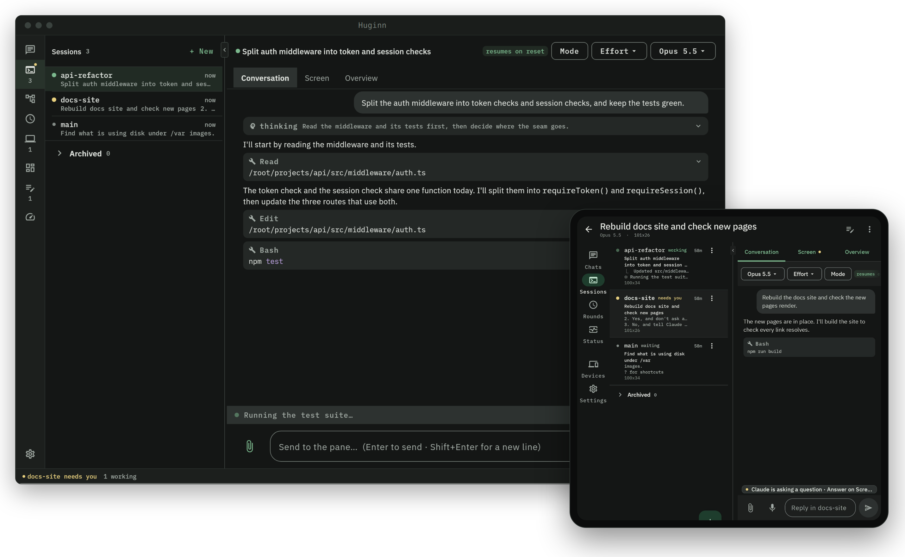

<div align="center">

<picture>
  <source media="(prefers-color-scheme: dark)" srcset="assets/brand/lockup-dark.svg">
  
</picture>

**thought, on call from anywhere**

Claude Code on a server you own, within reach of every device you use.

[](https://github.com/silencelen/huginn/releases)
[](LICENSE)


[Install](#install) · [Documentation](docs/README.md) · [Releases](https://github.com/silencelen/huginn/releases) · [Discussions](https://github.com/silencelen/huginn/discussions)

</div>

<p align="center">
  
</p>

## What it is

Huginn keeps your Claude Code sessions running on one always-on machine and lets you pick
them up from anywhere: start a task at your desk, check on it from your phone, finish it on
a laptop. It has two parts:

- **Huginn Server** runs on a Linux machine you control, such as a VM, a container or a small
  home server. It hosts Claude Code in persistent sessions and serves the clients.
- **Huginn Client** runs on each of your computers: the `huginn` command and a small
  background service, with an optional desktop app. An Android app connects the same way.

What you get:

- **Sessions that outlive the connection.** Close the laptop mid-task and the work keeps
  going. Reconnect from any device to the same session, exactly where it was.
- **One session, many screens.** A terminal on Linux, Windows or Termux, the desktop app on
  Windows and Linux, and the Android app all show the same live sessions.
- **Readable session views.** The apps show each session's conversation, built from Claude
  Code's own transcript, next to its live terminal screen.
- **Permission prompts as buttons.** Answer Claude Code's questions from the app, or from
  the Android lock screen.
- **Chats.** Quick questions without tools, or tasks with tools, streamed as they run.
- **Your other machines as workers.** Let Huginn run jobs on your laptop or desktop, within
  limits you set on that machine.
- **Usage awareness.** Huginn watches your plan's limits, warns before a session runs out,
  and resumes stalled work when the limit resets.

Huginn signs in with your Claude Pro or Max subscription (or an API key) and works entirely
on your own network. Nothing needs to be exposed to the internet.

## How it fits

```text
  your devices                                      your server
  +--------------------------+    SSH, port 22     +------------------------------+
  | huginn (CLI + core)      | ------------------> | Claude Code in tmux sessions |
  | Huginn desktop app       |    HTTPS, port 8787 | huginn-appd (the daemon)     |
  | Huginn for Android       | ------------------> |                              |
  +--------------------------+                     +------------------------------+
            your LAN, or a VPN you control (WireGuard, Tailscale, ...)
```

## Install

**1. The server.** A dedicated Debian 12/13 or Ubuntu 22.04/24.04 machine, as root:

```bash
curl -fsSL https://raw.githubusercontent.com/silencelen/huginn/main/server/get.sh | sudo bash
claude      # sign Claude Code in, once
```

**2. Each computer.** The installer asks whether to add the desktop app, then pairs the
computer with your server:

```bash
# Linux, Termux
curl -fsSL https://raw.githubusercontent.com/silencelen/huginn/main/client/get.sh | sh
```

```powershell
# Windows 10 and 11
irm https://raw.githubusercontent.com/silencelen/huginn/main/client/get.ps1 | iex
```

**3. Android (optional).** Install the APK from the newest
[`app-v` release](https://github.com/silencelen/huginn/releases) and enter your server's
address and access token.

Then run `huginn` to open the console, or `huginn main` to attach to your main session.
The [installation guide](docs/install/README.md) covers each step, the requirements and the
options in detail.

## Documentation

| | |
|---|---|
| [Installation](docs/install/README.md) | server, clients, Android, networking, updating, uninstalling |
| [User guide](docs/guide/README.md) | sessions, the console, the apps, chats, devices, projects, usage limits |
| [Reference](docs/reference/README.md) | commands, environment variables, server configuration, the API |
| [Security](docs/security.md) | what Huginn exposes, how it is protected, and a hardening checklist |
| [FAQ](docs/faq.md) | common questions and problems |
| [Contributing](CONTRIBUTING.md) | building, testing and submitting changes |

## Platform support

| Part | Supported |
|---|---|
| Server | Debian 12 and 13, Ubuntu 22.04 and 24.04 (x86_64 and arm64) |
| Client and core | Linux (x86_64, arm64), Windows 10 and 11 (x64) |
| Terminal client only | Termux on Android |
| Desktop app | Windows 10 and 11, Linux (`.deb`, Arch package, portable) |
| Android app | Android 10 and later, arm64 |

macOS is not supported. Windows builds are signed, but not yet with a publicly trusted
certificate: Windows SmartScreen will report an unknown publisher. See
[Verifying downloads](docs/install/verify.md).

## Contributing

Bug reports, ideas and pull requests are welcome. Start with
[CONTRIBUTING.md](CONTRIBUTING.md), and ask questions in
[Discussions](https://github.com/silencelen/huginn/discussions). Report security issues
privately, as described in [SECURITY.md](SECURITY.md).

## License

[MIT](LICENSE). Huginn is named for one of Odin's two ravens, the one called *thought*.
