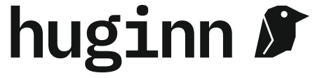

<div align="center">

<picture>
  <source media="(prefers-color-scheme: dark)" srcset="assets/brand/lockup-dark.svg">
  
</picture>

### thought, on call from anywhere

**One command to reach a persistent [Claude Code](https://docs.anthropic.com/en/docs/claude-code) session running on your own server — from your laptop, desktop, or phone.**
**Plus native Android and desktop apps: chats, live session views, and permission prompts answered from your lock screen.**

[](LICENSE)


[**Setup**](docs/SETUP.md) · [**Usage**](docs/USAGE.md) · [**Architecture**](docs/ARCHITECTURE.md) · [**FAQ**](docs/FAQ.md) · [**Security**](docs/SECURITY.md)

</div>

---

Named for **Huginn**, one of Odin's two ravens — *thought* (his brother **Memhost** is *memory*). The ravens fly out over the world each day and return to tell him what they saw. Huginn here is your thinking surface: a Claude Code session that lives on an always-on host, that you attach to from any device, **mirrored and reattachable** — start something on your phone, pick it up full-screen at your desk.

```console
# at your desk
PS C:\> huginn                  # attach the live session; run: claude
…working on a long task… then you close the lid. it keeps running —
and when you wake the laptop, huginn auto-reconnects you right back in.

# later, from your phone (Termux) — same session, right where you left it
~ $ huginn
~ $ huginn list
main: 1 windows (attached)

# back at the desk — kick the phone and go full-screen
PS C:\> huginn solo
```

> 💡 **Want an animated demo?** A [VHS](https://github.com/charmbracelet/vhs) script lives at [`assets/demo.tape`](assets/demo.tape) — point it at your host and run `vhs assets/demo.tape` to render `docs/demo.gif`.

```text
┌────────────────────────────────────────────────┐
│                                                │
│                 ▄▄██████▄                      │
│               ▄██████▀▀████▄                   │
│              ▄███████  ███████▄▄               │
│               ███████▄▄████████▀               │
│             ▄▄██████████████▀                  │
│             ██ ████████████                    │
│             ██▄▀███████████                    │
│            ▄███ ███████████                    │
│            █████▀██████████                    │
│            █████ ██████████                    │
│           ▄█████ █████████                     │
│           █████ ██████████                     │
│           ████ ██████████                      │
│          ▄███ ███████▀                         │
│          █████████▀                            │
└────────────────────────────────────────────────┘
```

<sub>The raven is the terminal art: this is the mark's own raster, printed by `huginn status` on the host. Brand rules: [assets/brand/BRAND.md](assets/brand/BRAND.md).</sub>

## Why

> I found myself driving all my Claude Code sessions from my laptop, instead of from where I was actually working. It let me centralize my knowledge and session store in one place — but it bound me to that one machine. **Huginn is my solution.**

|   |   |
|---|---|
| ♾️ **Always there** | Long/agentic tasks keep running when you close the lid. Wake the machine and huginn **auto-reconnects** you — exactly where you left off. |
| 📱 **Any device, one session** | `huginn` from laptop, desktop, or phone attaches the *same* live session. |
| 🪞 **Mirror or solo** | Two devices mirror each other (fit the smaller screen); one keystroke (`Alt-o`) detaches the rest to go full-screen. An auto-reconnect picks the right mode for you. |
| 🏷️ **Live status tabs** | `huginn costtracking` labels the terminal tab `costtracking` (Windows Terminal / iTerm / Termux) **with a live state icon** — 🔄 working · ✋ needs you (permission/input) · ✅ waiting for your next prompt — so you can tell at a glance, across tabs, which session wants you. The title that was there before is put back when you leave (on any terminal with a title stack — [which, and why](docs/USAGE.md#named-terminal-tabs)). |
| 💸 **Subscription, not metered** | Log Claude Code into your **Max/Pro** plan — flat cost, no per-token billing. (API key works too.) |
| 🔌 **No open ports** | The terminal path is just SSH. Add Tailscale/WireGuard and it works from anywhere. The optional background core listens on nothing but a local socket only you can open; the apps' daemon is the opt-in exception. |
| 🖥️ **Your machines, always on call** | *(optional)* `huginn core` keeps a laptop, desktop or server available to huginn as a place to run work — from boot, with nobody signed in — without the desktop app open. |
| 📲 **Native apps, opt-in** | An Android app and a Windows/Linux desktop app (one shared Kotlin codebase) with streaming chats, structured session views, push notifications, and permission prompts as tappable buttons — [see below](#-the-apps-optional). |
| 📊 **Never silently capped** | *(with the daemon)* huginn watches the plan's usage windows: it warns a session before it runs out, steps it down a model **for that session only** (never rewriting your default), holds new subagent spawns while the account is tight, and resumes what stalled the moment the limit resets. `huginn headroom` shows the whole picture — [details](docs/USAGE.md#headroom-usage-limits). |
| 🪶 **Small pieces** | The terminal path is a few shell scripts + a tmux config. The value is the *pattern*. |

## Quick start

**1. Provision a host** — a Proxmox LXC, a VM, a Raspberry Pi, or any always-on Debian/Ubuntu box. See [`provision/`](provision/).

**2. Set it up** (on the host):
```bash
git clone https://github.com/silencelen/huginn.git
sudo bash huginn/server/setup.sh
claude        # log in once with your Max/Pro subscription (or set ANTHROPIC_API_KEY)
```

**3. Install on each device** — one line:

```bash
# Linux · macOS · Termux
curl -fsSL https://raw.githubusercontent.com/silencelen/huginn/main/client/get.sh | sh -s -- <host-ip-or-name>
```
```powershell
# Windows (PowerShell)
& ([scriptblock]::Create((irm https://raw.githubusercontent.com/silencelen/huginn/main/client/get.ps1))) -HuginnHost <host-ip-or-name>
```

It installs the `huginn` command from the newest release, adds a `Host huginn` SSH alias, prints this
machine's key for you to authorize on the host, installs `huginn core` (it carries the CLI and runs
at boot; not on Termux or macOS), asks one question, and ends with what it installed:

- **Install the desktop app too?** — Windows and Linux.

Answer up front for unattended installs: `HUGINN_GUI=n` (shell) or `-Gui n` (PowerShell). From a clone, `client/install.sh` / `client/install.ps1`
still install the command alone.

**4. Go:**
```
huginn               attach/create the live 'main' session
huginn solo          attach + detach other clients (full-screen resume)
huginn work          a separate named session
huginn -p "..."      one-shot headless query
huginn status        health at a glance
huginn usage         Claude Code token/cost report
huginn update        self-update this client from the repo
huginn help          full reference
```

**5. Optional — the apps:** deploy the daemon and build the Android / desktop clients — see [`mobile/README.md`](mobile/README.md) and [the apps](#-the-apps-optional) below.

## huginn core (optional)

The terminal client stays a thin SSH front end. **`huginn core`** is an optional, per-user
background service — one Go binary — for machines that should also *do* work: it enrols the
machine as a huginn device, runs the jobs huginn sends it (read-only *ask*, or *act* with tools, by
the scope you set on that machine), and starts **at boot, as you, with nobody signed in**
(a `systemd --user` unit with linger on Linux; a scheduled task on Windows).

```
huginn core install     start it at boot and pair it with the host (over the SSH you already have)
huginn device on        offer this machine   [--scope look|work|own] [--root DIR]
huginn core status      is it running, paired, and what it offers
```

What the host may do to the machine is decided **on the machine**, by its own policy, never by
the request; a locked screen withdraws *act* unless you say otherwise. The desktop app is a
window onto the core and every desktop install brings one. Design:
[`docs/CORE-ARCHITECTURE.md`](docs/CORE-ARCHITECTURE.md).

> Windows builds are Authenticode-signed. Until the publicly trusted certificate is in place,
> Windows machines outside the author's own domain will show an unknown publisher.

## In a session

| Key | Action |
|---|---|
| `Alt-d` | detach (keeps running) |
| `Alt-o` | detach **all other** clients → full-screen |
| `Ctrl-b [` | scroll back |

The status bar shows these hints on the left. Full reference: [`docs/USAGE.md`](docs/USAGE.md).

## The apps (optional)

The terminal is the core; the apps are the comfortable way to live with it. One Kotlin
codebase (`mobile/`) builds both an **Android app** and a **Windows/Linux desktop app**,
talking to `huginn-appd` — a zero-dependency Node daemon on the host — over HTTP + SSE:

- **Chats** — headless Claude turns streamed token by token, in *ask* (read-only-intent)
  or *act* (tools) mode, with attachments (camera / photos / any file, transcoded and
  streamed up to 128 MB).
- **Sessions** — every tmux session, twice: a **Conversation** view built from the real
  Claude Code transcript (thinking, tool calls, subagents — structure, not screen-scraping)
  and a **Screen** view of the live pane, resized to your device while you watch.
- **Prompts become buttons.** A numbered permission question in the pane turns into
  tappable options — in the app *and* on the Android lock screen, fingerprint-checked
  host-side so a stale tap can never answer a question you didn't see.
- **Notifications that survive a sleeping phone** — high-priority FCM (measured tens of
  milliseconds into deep Doze), an alarm fallback, and optional Telegram from the host;
  stale alerts take themselves down when you answer elsewhere.
- **Desktop niceties** — tray with live state, `Ctrl+K` palette, keyboard-first
  navigation, self-updating installers for Windows, a `.deb`, a native Arch package and a
  portable self-updating Linux build, all built on a Linux host (Windows installer
  included — jpackage under wine, no Windows box needed). Every desktop install brings
  [`huginn core`](#huginn-core-optional).

Start at [`mobile/README.md`](mobile/README.md) for what they do and how to build them,
and read [`docs/SECURITY.md`](docs/SECURITY.md) **before** deploying the daemon — it is a
second root-equivalent credential and the docs treat it that way. There was an older
Electron desktop client; it was retired and deleted on 2026-08-27 — the Compose one at
`mobile/app-desktop` is the desktop client.

## Isn't this just `ssh` + `tmux`?

Yes — and that's the point. Huginn is `ssh` + `tmux` + `claude` with the sharp edges filed off: sensible multi-device tmux defaults (mirror, quick-detach, solo), a friendly one-word command with subcommands and tab-completion across PowerShell **and** bash/Termux, a container template, and a one-shot setup. The magic isn't new tech — it's the *packaging*.

Being an `ssh` front end is also why the CLI drives **one** host: every verb that needs the daemon runs *on that host* against `127.0.0.1:8787`, reading `/etc/huginn-appd/token` there, so the bearer token never reaches your laptop and there is no client-side daemon address to point somewhere else. `HUGINN_HOST` chooses which box you ssh to, and that box's own daemon is the one you get. To drive a second host, ssh to it (`HUGINN_HOST=other huginn …`) — the phone and desktop apps are the clients that hold an address and a token of their own.

## What's in here

| Path | What |
|---|---|
| [`provision/`](provision/) | Container template (Proxmox LXC) + a generic "any Debian/Ubuntu host" path |
| [`server/`](server/) | `setup.sh`, the `cc` launcher, `huginn-status`, a tuned `tmux.conf` |
| [`server/appd/`](server/appd/) | the phone daemon: sessions, chats, push, prompts-as-buttons over the tailnet |
| [`client/`](client/) | `huginn.ps1` + `huginn.sh` + the one-line installers (`get.sh`, `get.ps1`) + clone installers + an optional Termux detach button |
| [`core/`](core/) | `huginn core` (Go): the per-user background service — device runner, local socket API, boot service, self-install |
| [`mobile/`](mobile/) | the Kotlin clients and the code they share: `:core` (logic + HTTP), `:ui` (Compose), `:app` (Android — [changelog](mobile/CHANGELOG.md)), `:app-desktop` (Windows/Linux — [changelog](mobile/app-desktop/CHANGELOG.md)) |
| [`docs/`](docs/) | [Setup](docs/SETUP.md) · [Usage](docs/USAGE.md) · [Architecture](docs/ARCHITECTURE.md) · [Core](docs/CORE-ARCHITECTURE.md) · [Adding a feature](docs/ADDING-A-FEATURE.md) · [Desktop migration](docs/DESKTOP-MIGRATION.md) · [FAQ](docs/FAQ.md) · [Security](docs/SECURITY.md) |

## Memory (the other raven)

Huginn is *thought*. Its companion is **Memhost** — *memory*: an optional MCP-backed memory layer so Claude remembers across sessions. That's out of scope here, but Claude Code's `claude mcp add ...` is the hook. See [Architecture → Extending it](docs/ARCHITECTURE.md#extending-it).

## Contributing

Issues and PRs welcome — see [`CONTRIBUTING.md`](CONTRIBUTING.md). Security reports: [`SECURITY.md`](SECURITY.md).

## License

[MIT](LICENSE) © silencelen
