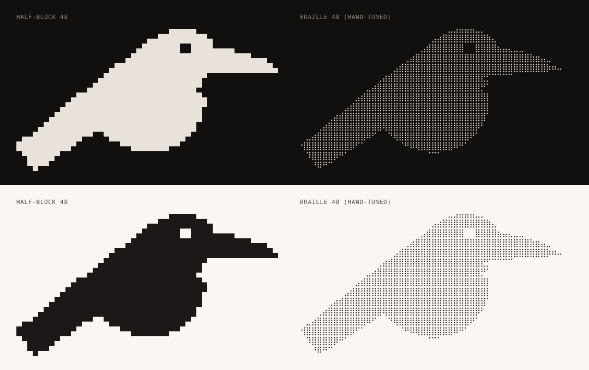

# ascii-01-portrait-large — the raven at 48 columns



**Surface: Unicode.** For server-printed surfaces only: a splash after attach,
`huginn-status`, the installer's console page, README and docs. Never for
`client/huginn.sh` or `client/huginn.ps1` (ASCII-only; see `../README.md`). The
`--about` use listed earlier is dropped: the client prints `--version` and must
stay ASCII, so a 48-column raven can only come from the server side.

**Concept.** The canonical mark sampled straight from `raven.svg` into two
terminal alphabets at 48 columns: half-block (`▀▄█`, 1×2 pixels per cell) and
braille (`⠁..⣿`, 2×4 dots per cell). Both come out of `../svg2ascii.py`; the
braille grid was then touched by hand (bill tapered to a point, tail point),
the half-block needed nothing on the current mark. At this size the raven is
unambiguous in both and the eye survives as a hole, which is the mark's one rule.

**Intended uses.** A terminal "poster" in docs, the installer's console page,
the opening frame of a terminal animation, a server-side `huginn-status
--banner` if one is added: anywhere with at least 48 columns and 15 rows to
spare and a font the brand controls. Too big for a README hero (see 02) and far
too big for a prompt (see 03).

**Strengths.**
- Reads as the raven, not as "some bird", in both alphabets; the bill, the
  throat notch, the wedge tail and the eye all survive.
- Half-block is the safest art a terminal can show: the file needs nothing from
  the font but `▀▄█`, and its padding is plain spaces (the earlier U+2800
  padding quietly needed a braille glyph; gone).
- Braille is the finest version (96×60 dots) and looks like a halftone print,
  which suits the "parchment ink" of the palette better than solid blocks do.
- Reproducible: `../regen.sh <mark>` regenerates `gen/` from any SVG;
  `raven-48-half.txt` is byte-identical to `gen/half.txt`, the braille differs
  from `gen/braille.txt` in 2 lines (the hand tuning).

**Weaknesses.**
- Braille depends on the font (see the root README: Cascadia and Termux fine,
  Consolas not, DejaVu Sans Mono falls back to a proportional font).
- 15 rows is taller than most splash budgets; the medium (02) is the practical
  size.
- The seam-free look in `preview.png` is the look of kitty, WezTerm, Alacritty,
  foot and Windows Terminal, which draw block elements themselves. Font-drawn
  blocks can show hairline seams, and GitHub's 1.45 line-height puts gaps
  between rows of any block art (`../ascii-02-portrait-medium/preview-github.png`).
- The shaded style is not a candidate at this size: one coverage level per
  cell with a 1:2 cell turns the anti-aliased edge into a `▒▓` fringe that
  reads as noise. It is kept under `extras/` at 80 columns, where it becomes a
  credible poster on a dark ground (still a little noisy on light), and at 48
  as the hand-tuned dither source for animation work. Look at
  `extras/preview-shaded.png` before using either.

**Relation to the current mark and palette.** Pure derivation: no reinterpretation,
the silhouette is the evenodd path of `assets/brand/raven.svg` at 1024px sampled
down. Rendered bone `#E8E2DA` on `#12100F` and ink `#1B1817` on `#FAF7F2`; the
art itself is colourless and takes whatever the terminal's foreground is, which
is the monochrome-first rule in practice.

## Files

| file | what |
|---|---|
| `raven-48-half.txt` | 15×48, half-block, space padded (the one to ship) |
| `raven-48-braille.txt` | 15×48, braille, hand-tuned bill tip and tail point, U+2800 padded |
| `src/half-48.grid`, `src/braille-48.grid` | the sub-pixel grids the art is packed from (`#`/`.`); edit these, not the .txt |
| `src/shaded-48.grid` | the hand-tuned shaded grid (digits 0–9), packed into `extras/` |
| `extras/raven-80-shaded.txt` | 24×80 `░▒▓█` poster, straight from the pipeline; not a candidate |
| `extras/raven-48-shaded.txt` | 14×48 shaded, hand-tuned; dither source only |
| `extras/preview-shaded.png` | both of the above on dark and light |
| `gen/` | untouched pipeline output for the current mark in all four styles (`.txt` and `.grid`, quarter included), overwritten by `regen.sh` |
| `preview.png` | half-block and braille on dark and light, 10×18 px cells |

```
                            ▄▄▄▄▄
                        ▄▄█████████▄
                      ▄███████  ████▄▄▄▄
                    ▄██████████████████████▄▄▄
                 ▄█████████████████████████████▄
               ▄██████████████████▀
             ▄███████████████████▀
          ▄███████████████████████▄
        ▄█████████████████████████▀
      ▄███████████████████████████
    ▄████████████████████████████
 ▄▄█████████▀▀  ▀██████████████▀
██████████▀        ▀▀███████▀▀
 ▀█████▀
  ▀█▀▀
```
(trailing padding stripped here for readability; the .txt files carry it)

## Regenerate

```
../svg2ascii.py ../../raven.svg --style half --width 48            # glyphs
../svg2ascii.py ../../raven.svg --style half --width 48 --grid     # editable grid
../svg2ascii.py src/half-48.grid --style half                      # grid -> glyphs
```

## Revision

Quarter-block dropped from the shipped set (it was byte-identical to `gen/` and
differed from half-block in edge cells only; it still exists in `gen/`). Shaded
demoted to `extras/` with an 80-column version added, since 48 is where it
fails. Block files re-packed with space padding. Surface statement added and the
`--about` use removed. Preview re-rendered at 10×18 (was 8×14, not comparable
with 02 and 03).
