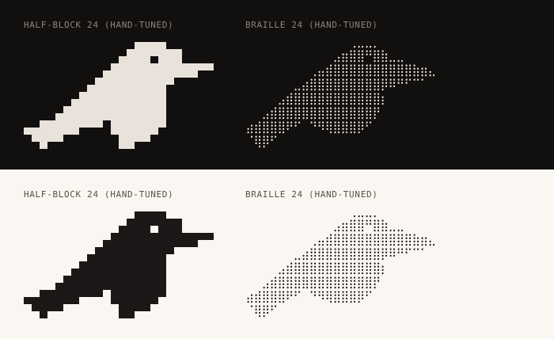

# ascii-02-portrait-medium — the raven at 24 columns (splash / README size)



**Surface: Unicode.** Printed by the server after attach (the splash), by the
installer's console page, and in README/docs. Not by `client/huginn.sh` or
`client/huginn.ps1`: those are ASCII-only, and their equivalent is the 4-line
ASCII raven in `../ascii-03-compact/raven-4line-ascii-a.txt` and the help header
in `../ascii-04-lockups/help-header-ascii.txt`. If "the CLI splash" is wanted
before ssh connects, it is the ASCII banner; once attached, the server can print
this one (`huginn-status` already prints Unicode).

**Concept.** The size the brand will actually be seen at in a terminal: 24
columns by 8 rows, which fits beside a figlet wordmark inside 80 columns and
above a command prompt without scrolling anything away. Two alphabets: a
half-block version redrawn pixel by pixel from the sampled grid (the raw sample
at this size has a stick tail and a smeared bill), and a braille version (48×32
dots) sampled at threshold 0.45 and then hand-tuned: the bill underside is now a
taper from the tip back to the throat instead of a two-row step, and the tail
ends in two dots instead of one. The half-block raven keeps a one-pixel eye hole
with ink on every side, a seven-pixel bill that tapers to a single pixel at the
tip, the throat notch and a three-step wedge tail.

**Intended uses.** Server-side splash after attach, the installer's console
page, the README hero when it is written as text (see
`../ascii-04-lockups/lockup-d-readme-hero.txt`), the first frame of a terminal
animation, a Termux welcome printed by the host (24 columns leaves room for a
wordmark underneath, not beside).

**Strengths.**
- Reads as *the* raven at a 16px cell: bill, eye, throat, tail all there
  (`preview.png`, 10×18 cells).
- 8 rows tall, so it survives a 24-row terminal with a wordmark and a prompt.
- The half-block file needs nothing from the font beyond `▀▄█`: padding is
  plain spaces.
- Braille version is noticeably finer and still reads at this size; good for
  docs and for terminals whose braille is known to be good, and the only one of
  the two that survives GitHub's 1.45 line-height (`preview-github.png`).

**Weaknesses.**
- The half-block head is a little square (two rows is all the head gets) and
  the eye is one pixel, which is a `▀` or `▄` sliver in a cell: on a font-drawn
  block with gaps between rows the eye can vanish into the gap.
- On GitHub's README (line-height 1.45) the half-block version shows horizontal
  stripes (`preview-github.png`); use the braille version or a rendered image
  there.
- Braille depends on the font (root README).
- Hand-tuning does not transfer automatically: a new mark means a new
  `src/half-24.grid`. The pipeline output in `gen/` is the starting point and is
  about 80 % of the way.

**Relation to the current mark and palette.** The half-block grid is a hand
re-drawing of the sampled canonical silhouette (same proportions: bill 29 % of
the width, eye on the bill's top edge, tail as a straight wedge). Monochrome;
previewed in bone on `#12100F` and ink on `#FAF7F2`.

## Files

| file | what |
|---|---|
| `raven-24-half.txt` | 8×24 half-block, hand-tuned, space padded (the one to ship); differs from `gen/half.txt` in 8 lines |
| `raven-24-braille.txt` | 8×24 braille, hand-tuned, U+2800 padded; differs from `gen/braille.txt` in 2 lines |
| `src/half-24.grid` | the 24×16 pixel grid the half-block art is packed from |
| `src/braille-24.grid` | the 48×32 dot grid, hand-tuned rows 12–15 (bill underside) and 31 (tail tip) |
| `gen/` | raw pipeline output for the current mark, overwritten by `regen.sh` |
| `preview.png` | both on dark and light, 10×18 px cells, blocks drawn as cells |
| `preview-fontdrawn.png` | the same with DejaVu's own block glyphs (the xterm look) |
| `preview-github.png` | font-drawn at line-height 1.45: the block version stripes, braille does not |

```
              ▄▄▄▄
            ▄███▀███
          ▄███████████▀▀
        ▄█████████▀
      ▄███████████
    ▄█████████████
▄▄█████▀▀▀ ██████▀
 ▀█▀▀       ██▀▀
```

## Regenerate

```
../svg2ascii.py ../../raven.svg --style half --width 24 --grid > gen/half.grid   # then edit into src/
../svg2ascii.py src/half-24.grid --style half --out raven-24-half.txt
../svg2ascii.py src/braille-24.grid --style braille --out raven-24-braille.txt
```

## Revision

Braille grid hand-tuned (bill underside, tail tip) and the README no longer
calls it untuned. Half-block re-packed with space padding. Surface statement
added; the `huginn --about` use removed (client file, ASCII-only) and pointed at
the ASCII twins in 03 and 04. Preview re-rendered at 10×18 with the fixed
`preview.py` (the mid-cell hairlines in the previous 9×16 render were a renderer
bug, not the art); two honesty renders added (`preview-fontdrawn.png`,
`preview-github.png`).
