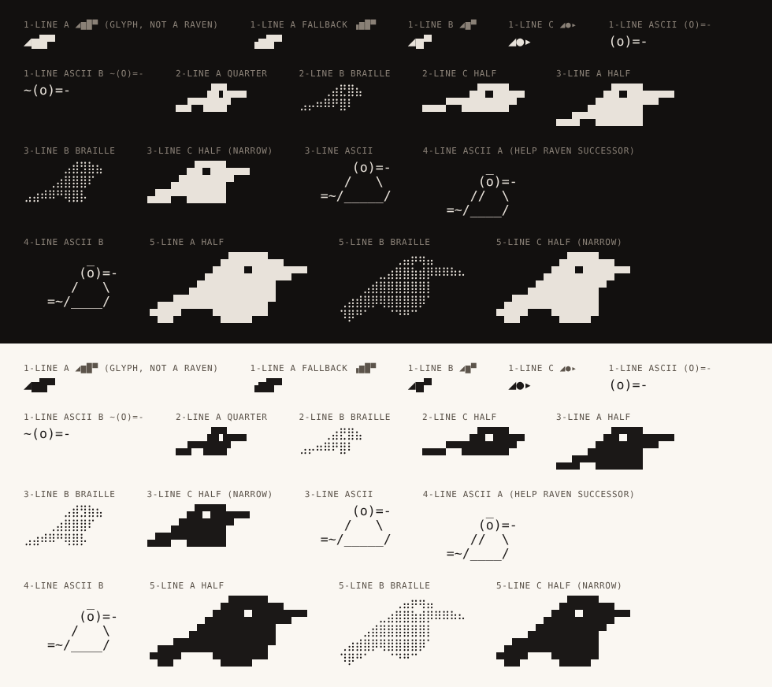

# ascii-03-compact — hand-drawn tiny ravens (1, 2, 3, 4 and 5 lines), Unicode and ASCII



Look at `preview.png` first (10×18 px cells, i.e. a 16px terminal, which is the
scale these will live at) and `preview-zoom.png` second (2× cells) to see the
construction.

**Surface.** Two families, stated per file below. *Unicode* (block, quarter,
braille, geometric glyph): printed by the server after attach, by `tmux.conf`,
by `huginn-claude-title`, in README and docs. *ASCII* (`raven-*ascii*.txt`,
7-bit, asserted by `../check.py`): the only ones allowed in `client/huginn.sh`
and `client/huginn.ps1`, and fine everywhere else. Not for the apps: they use
`Typeface.MONOSPACE` with no bundled font, so block elements come from a
fallback face with its own advance width and text art misaligns; the apps have
the vector mark for every slot that needs a raven.

**Concept.** The smallest ravens: the ones that go in a prompt, a tmux status
segment, the first line of output, a `--help` header, a banner. Nothing here is
sampled from the SVG; each is drawn by hand on a pixel grid (`src/*.grid`),
typed from geometric glyphs, or typed in ASCII, then the grids are packed with
the same `svg2ascii.py` so the construction is reproducible. The design rule at
this scale, in order of priority: the long tapered bill (the mark's longest
feature, ~30 % of its width), the raised head, the wedge tail. The eye is kept
wherever there is a row to spare (2 lines and up in every style now).

**Intended uses.**
- 1 line: tmux `status-left` (Unicode glyph), the server's first line after
  attach, the client's first line and help screen (ASCII glyph), log prefixes.
- 2 lines: two-row status bars, a sidebar header in a TUI.
- 3 lines: beside a slim wordmark (`../ascii-04-lockups/lockup-b-calvin.txt`),
  TUI headers; the ASCII 3-line for narrow client output.
- 4 lines (ASCII): the `huginn --help` top in both client files, a drop-in for
  today's `(o)==-` raven (`huginn.sh:988`, `huginn.ps1:814`).
- 5 lines: beside the ANSI Shadow wordmark, the installer's console, the
  server-side splash on a short terminal.

## Candidates

### 1 line

| id | glyphs | family | reads as | notes |
|---|---|---|---|---|
| **a** `raven-1line-a.txt` | `◢▆█▀` | Unicode | a monogram: tail wedge, body, raised head, bill | the pick for tmux and the server's first line. It is derived from the mark's silhouette and is distinctive as a prefix; it is **not** a picture of a raven and nobody will name it one unaided. The head (`█`) rises above the body (`▆`, 3/4 block) so the bill (`▀`) sits at head height. 4 cells. |
| `raven-1line-a-fallback.txt` | `▗▆█▀` | Unicode | a step | what to print where `◢` is missing; shown beside (a) in the preview so the difference is visible: it loses the slope and reads as stairs |
| b `raven-1line-b.txt` | `◢▆▀` | Unicode | wedge with a flag | 3 cells for tight segments |
| c `raven-1line-c.txt` | `◢●▸` | Unicode | round bird | friendlier, less raven, all geometric shapes so its weight varies by font |
| **ascii** `raven-1line-ascii.txt` | `(o)=-` | ASCII | an eye and a bill | the pick for the client files; the direct descendant of today's `(o)==-` with one `=` fewer so it is 5 cells |
| ascii-b `raven-1line-ascii-b.txt` | `~(o)=-` | ASCII | eye, bill and a tail | 6 cells; a touch more bird |

`◢` (U+25E2) is in DejaVu Sans Mono (verified with `fc-list`), hence in Menlo
and Hack, and in Cascadia; JetBrains Mono, Fira Code and others cover Geometric
Shapes only partially, so check. It is a *glyph*, not a block element: DejaVu
draws it inset (a hairline gap before `▆`), Cascadia draws it filling the cell.
`◢▆█▔` (an eighth-block bill) was tried: the hairline reads as a pole, not a
bill, so (a) stays.

### 2 lines

| id | style | family | verdict |
|---|---|---|---|
| **c** `raven-2line-c-half.txt` | half-block, 13 cols | Unicode | redrawn: head, eye hole, 4-px bill, body, wedge tail. The pick: the only 2-line raven that needs nothing but `▀▄█`. |
| a `raven-2line-a-quarter.txt` | quarter-block, 9 cols | Unicode | finer; eye, bill, sloping tail, belly notch. Needs quadrant glyphs. |
| b `raven-2line-b-braille.txt` | braille, 8 cols | Unicode | finest; reads as a dotted bird. Font-dependent. |

```
      ▄█▀██▄▄          ▟▛▙▄▄        ⠀⠀⠀⢀⣴⣟⣿⣦
▄▄▄▀▀██████▀       ▄▟▀▜██▛          ⣠⡤⠶⠿⠟⣿⠇⠀
```

Four pixels of height is the hard limit: the eye and the bill want the same
row. The earlier half-block 2-line (`◢███▀` under `▄██▀▀▀`) read as a flag and
is gone.

### 3 lines

| id | style | family | notes |
|---|---|---|---|
| **a** `raven-3line-a-half.txt` | half-block, 15 cols | Unicode | eye, 6-px tapered bill, wedge tail. The pick. |
| b `raven-3line-b-braille.txt` | braille, 10 cols | Unicode | finer, same silhouette, shorter bill (untouched pipeline output with the eye cut in). |
| c `raven-3line-c-half.txt` | half-block, 13 cols | Unicode | 5-px bill, for narrow slots. |
| **ascii** `raven-3line-ascii.txt` | ASCII, 11 cols | ASCII | `(o)=-` head, `/ \` body, `=~/___/` tail; for narrow client output. |

```
      ▄█▀██▄▄▄▄        ⠀⠀⠀⠀⠀⣠⣾⣻⣷⣦         ▄█▀██▄▄▄         (o)=-
    ▄██████▀▀          ⠀⠀⠀⢀⣴⣿⣿⣿⠏⠀       ▄██████▀         /   \
▄▄█▀▀██████            ⣠⣴⠾⠿⠛⢿⣿⡧⠀⠀     ▄▄█▀▀█████       =~/_____/
```

### 4 lines (ASCII only)

| id | notes |
|---|---|
| **a** `raven-4line-ascii-a.txt` | the successor to today's help raven: same `_` crown and `(o)=-` head, a wider body with the `//` wing stroke kept from the original, a longer `=~/____/` base. 12 columns, same footprint as today's 13. The pick. |
| b `raven-4line-ascii-b.txt` | the same with a single `/` wing stroke; quieter. |

```
        _                 _
       (o)=-             (o)=-            today:        _
      //  \             /   \                          (o)==-
   =~/____/          =~/____/                          //\
                                                    =~/_/
```

### 5 lines

| id | style | family | notes |
|---|---|---|---|
| **a** `raven-5line-a-half.txt` | half-block, 20 cols | Unicode | the pick: 7-px bill on the eye row, two rows thick at the base and one at the tip, wedge tail with the belly notch. |
| b `raven-5line-b-braille.txt` | braille, 16 cols | Unicode | pipeline output with a 2×2 eye cut in. |
| c `raven-5line-c-half.txt` | half-block, 17 cols | Unicode | narrower, 6-px bill. |

```
         ▄█████▄▄
       ▄████▄█████▀▀
     ▄██████████
 ▄▄████████████▀
▀██▀    ▀████▀▀
```

**Strengths.**
- From 2 lines up every size has a candidate that reads as a bird at 16px
  without a caption, and from 3 lines up as *this* raven (bill, eye, tail).
- Every size has a block-only (font-proof) candidate, and every client-facing
  size has a 7-bit twin.
- The Unicode glyph `◢▆█▀` is short enough for a tmux segment (` ◢▆█▀ main `
  is 11 cells) and distinctive as a prefix.
- Grid sources make every candidate editable and reproducible; `gen/` shows
  what the pipeline does unaided at these sizes.

**Weaknesses.**
- The 1-line glyphs are not ravens. `◢▆█▀` is a monogram and `(o)=-` is an eye
  with a bill; that is the ceiling of four or five cells.
- `◢` is a geometric-shape glyph whose size differs per font, so the 1-line
  glyph looks slightly different in every terminal; the fallback is weaker.
- Quarter-block and braille are font-dependent (root README).
- The 3-line braille has a shorter bill than its half-block sibling (untouched
  pipeline output); the ASCII ravens are font-drawn by nature and their weight
  follows the terminal's font.

**Relation to the current mark and palette.** The silhouettes are hand reductions
of the canonical raven, keeping its profile-right, feathers-over-feet posture and
its three identifiers; the ASCII ravens are refinements of the help raven that
has been in `huginn.sh` since the beginning. Monochrome; the coloured mock-ups
in 04 show the glyph in rune-gold on the status bar.

## Files

`raven-<size>-<id>[-<style>].txt` as in the tables; `src/*.grid` are the sources
of the block/quarter/braille art (`l2-half.grid` is new; the ASCII files are their
own source); `gen/` holds what the pipeline makes unaided at 2/3/5 lines for the
current mark at the shipped widths (13/15/20 columns for half-block);
`preview.png` (16px) and `preview-zoom.png` (2×).

## Regenerate

```
../svg2ascii.py src/l5-half-a.grid --style half      # any grid -> glyphs
../regen.sh --pack                                   # all of them + previews
```

## Revision

The 3- and 5-line half-block ravens were redrawn on wider grids (15 and 20
columns) with 6- and 7-px tapered bills on the eye row; the earlier 2-px stub
bills read as a pigeon, and the 3-line grid was ragged. The 2-line half-block
was redrawn with an eye and a bill from the quarter grid instead of being a
flag. ASCII twins added at 1, 3 and 4 lines, with today's help raven shown as
the baseline. The 1-line glyph is now described as a mark-derived monogram, and
its `▗▆█▀` fallback is in the preview. In-app uses (chat avatars, notification
titles) removed. Files re-packed with space padding; previews re-rendered.
