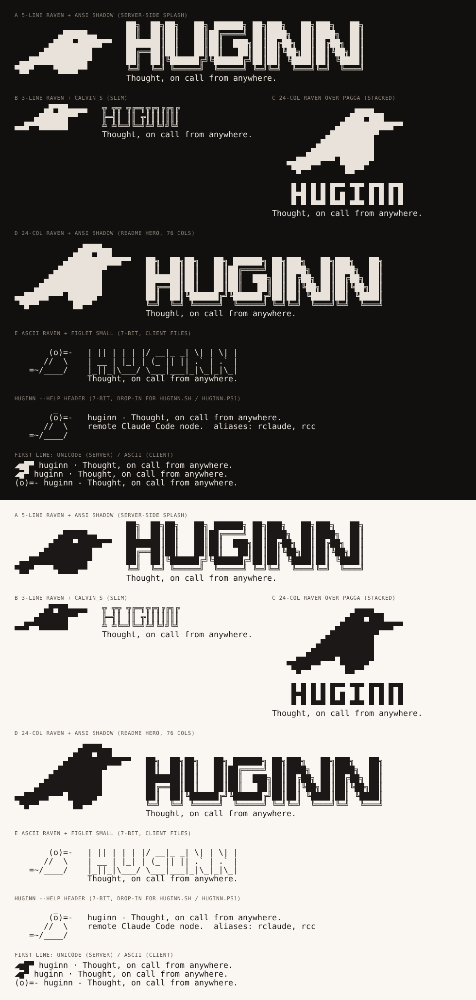

# ascii-04-lockups — raven + HUGINN wordmark, banners, help header, tmux segment



Then `preview-mocks.png` for the tmux status bar and the splash in brand colours.

**Concept.** The terminal lockups: a compact raven from 03 or the 24-column
raven from 02 set against a figlet HUGINN, plus the one-liners the CLI will show
most often, each in the family its surface can print. Faces tried with
`pyfiglet`: ansi_shadow, calvin_s, future, pagga, smblock, smslant (box/block
faces) and small, smslant, thin, mini, straight, standard, slant, cybermedium,
smshadow, shadow, drpepper, rectangles, smkeyboard, bubble (7-bit faces). Kept:
ANSI Shadow (today's README font, 6 rows), calvin_s (double-line box drawing,
3 rows, the slim one), pagga (half-block capitals, the one that speaks the same
alphabet as the half-block raven) and small (4 rows, the cleanest 7-bit face).
The wordmark is a stock figlet font by the brief's own admission; a real wordmark
is another designer's dimension, and `lockup.py` takes any figlet font name so
these recompose when that lands.

## What prints where

| file | parts | size | family | printed by | verdict |
|---|---|---|---|---|---|
| **a** `lockup-a-ansi-shadow.txt` | 5-line raven (03 a) left of ANSI Shadow, tagline under | 7×72 | Unicode | the server after attach (splash on an 80-column terminal) | raven and type have the same weight |
| b `lockup-b-calvin.txt` | 3-line raven (03 a) left of calvin_s, tagline under | 4×49 | Unicode | server-side headers, narrow Termux screens | elegant, quiet; the raven is the only solid thing on the line, which is the point |
| c `lockup-c-pagga-stacked.txt` | 24-column raven (02) above pagga, tagline | 13×31 | Unicode | the server on a phone-width terminal (Termux portrait is ~45 columns) | one alphabet, raven and letters |
| **d** `lockup-d-readme-hero.txt` | 24-column raven (02) left of ANSI Shadow | 9×76 | Unicode | README and docs, in a code block | the strongest of the four and the direct replacement for today's SVG + figlet hero |
| **e** `lockup-e-ascii.txt` | 4-line ASCII raven (03) left of figlet small, tagline under | 5×46 | ASCII | `client/huginn.sh`, `client/huginn.ps1` if a splash is wanted before ssh | the 7-bit splash; modest by design |
| **`help-header-ascii.txt`** | 4-line ASCII raven with the tagline and today's help line beside it | 4×62 | ASCII | the `huginn --help` heredoc in both client files (`huginn.sh:988`, `huginn.ps1:814`) | a drop-in: same four rows as today, longer bill, bigger body |
| `banner.txt` | `◢▆█▀ huginn · Thought, on call from anywhere.` | 1×45 | Unicode | the server's first line after attach, `huginn-status` | the glyph in rune-gold, the rest in the foreground |
| `banner-ascii.txt` | `(o)=- huginn - Thought, on call from anywhere.` | 1×46 | ASCII | the client's first line (hyphen, not middle dot) | the same line in 7 bits |
| `banner-variants.txt` | the two above plus the 3-cell glyph version | 3×46 | mixed | reference only | |
| `tmux-status-left.txt` | `◢▆█▀ main` | 1×9 | Unicode | `server/tmux.conf` | see below |

```
      ▄█▀██▄▄▄▄   ╦ ╦╦ ╦╔═╗╦╔╗╔╔╗╔                       _
    ▄██████▀▀     ╠═╣║ ║║ ╦║║║║║║║                      (o)=-   huginn - Thought, on call from anywhere.
▄▄█▀▀██████       ╩ ╩╚═╝╚═╝╩╝╚╝╝╚╝                     //  \    remote Claude Code node.  aliases: rclaude, rcc
                  Thought, on call from anywhere.    =~/____/
```

**Tagline.** "Thought, on call from anywhere." — sentence case with the full
stop, everywhere, terminal surfaces included; it is the README's and the
brief's form. (The earlier lowercase "thought" was an unexplained drift; dropped.)

## tmux status-left

Text-only design, three treatments in `preview-mocks.png`:

1. **quiet default:** raised-surface ground (`#241F1D`), glyph in rune-gold,
   session name in bone — "selection is a surface tint";
2. **needs you:** gold ground with ink glyph and name — "state is a small
   dot", here a tinted segment, shown only while Claude waits for the user;
3. the 3-cell glyph version for very narrow screens.

```tmux
# huginn tmux status bar, brand colours from Theme.kt
set -g status-style "bg=#12100F,fg=#8A8177"
set -g status-left-length 24          # " ◢▆█▀ " is 6 cells; leaves 17 for the session name
# Quiet by default. Gold ground only while Claude needs you: @huginn_state is set by
# huginn-claude-title next to its title escape (`tmux set -w @huginn_state needs-you`,
# and `working` / `waiting` otherwise). Commas inside the conditional are written `#,`.
set -g status-left "#{?#{==:#{@huginn_state},needs-you},#[fg=#241C09#,bg=#C8A45C#,bold] ◢▆█▀ #S #[default],#[bg=#241F1D]#[fg=#C8A45C] ◢▆█▀ #[fg=#E8E2DA]#S #[default]} "
# The keybind hints that live in status-left today move to the right.
set -g status-right "#[fg=#8A8177]Alt-d detach · Alt-o solo · ^b[ scroll  #h"
```

Both branches were expanded with `tmux display -p` on tmux 3.4 and produce the
intended segment. Contrast (`../../tools/contrast.py`): ink on gold 7.16:1,
gold on surface 6.92:1, bone on surface 12.67:1, muted on bg 4.96:1, all AA or
better.

**Strengths.**
- Every lockup is text, so it works in a README code block, the server's
  output, the installer console and a commit message alike, and the client
  files finally have something that is theirs (e, the help header, the ASCII
  banner).
- (d) is a credible README hero without an image; (a) gives the server-side
  splash an identity in 7 rows; the help header gives the client one in the 4
  rows it already spends.
- `lockup.py` recomposes from any raven file and any figlet font, so swapping
  in the final wordmark or a new mark is one command.

**Weaknesses.**
- ANSI Shadow's shadow (`╗║╝`) is drawn by the font while the raven's blocks
  are drawn by the terminal: in a terminal that draws neither, both can show
  seams; in one that draws only blocks, the wordmark's lines are thinner than
  the raven's edge. Visible in the preview as the outline-y feel of the letters.
- calvin_s is double-line box drawing, which some fonts render light; pagga's
  spacing between letters is a `▀`-less column and reads loose at small sizes;
  figlet small is thin next to any raven.
- A stock figlet face is still a stock figlet face; (a), (d) and (e) are only as
  "designed" as their fonts are.
- The tmux segment relies on `◢` rendering well in the status bar font, which
  on a phone (Termux) is the system fallback; the `@huginn_state` option needs
  one line added to `huginn-claude-title`.
- Tagline alignment under the wordmark is a fixed indent; a longer tagline
  will need `--gap`/indent changes.

**Relation to the current mark and palette.** Uses the hand-drawn ravens of 02
and 03 and today's ANSI Shadow wordmark unchanged; colours in the mocks are
exactly Bg/Surface2/Accent/AccentInk/Muted from Theme.kt.

## Files

`lockup-*.txt`, `banner.txt`, `banner-ascii.txt`, `banner-variants.txt`,
`help-header-ascii.txt`, `tmux-status-left.txt`; `tmux-status-mock.html` and
`splash-mock.html` (colour mock-ups for `preview.py` only, not deliverables);
`preview.png` (10×18 px cells) and `preview-mocks.png`.

## Regenerate

```
../lockup.py --raven ../ascii-03-compact/raven-5line-a-half.txt --font ansi_shadow --tagline "Thought, on call from anywhere."
../lockup.py --raven ../ascii-03-compact/raven-4line-ascii-a.txt --font small --tagline "Thought, on call from anywhere."
../lockup.py --raven ../ascii-02-portrait-medium/raven-24-half.txt --font pagga --stack --gap 1
python3 -c "import pyfiglet; print(pyfiglet.FigletFont.getFonts())"   # other faces
```

## Revision

ASCII twins added for every client-facing piece (`banner-ascii.txt`,
`help-header-ascii.txt`, `lockup-e-ascii.txt`) and a "printed by" column states
the family and the surface of every file. The tmux snippet makes the quiet
segment the default, puts the gold ground under a state condition, raises
`status-left-length` to 24 and moves the keybind hints to `status-right`. Tagline
capitalised everywhere. The figlet faces tried are listed instead of counted.
`lockup.py` honours `--gap` for `--stack` and pads with spaces. Previews
re-rendered at 10×18 with the fixed renderer; the colour mocks have their own
`preview-mocks.png`.
