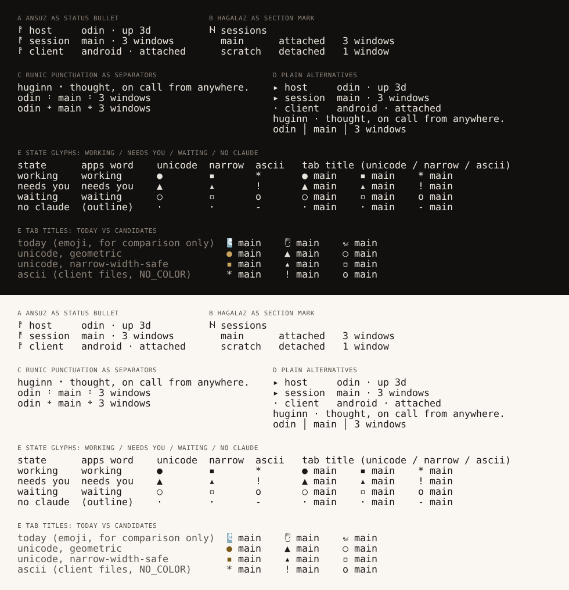

# ascii-05-runes — runes as bullets? No. And the state glyphs that replace the emoji

**Surface.** Examples A–D are Unicode and are a study, not deliverables. The
state glyph table (E) is both: the `unicode` and `narrow` columns are for the
server (`huginn-claude-title`, `huginn-status`, tmux) and the apps' terminal
view, the `ascii` column for `client/huginn.sh` and `client/huginn.ps1`.

## Part 1 — runes

**Concept.** A small study, as the brief asked: Ansuz `ᚨ` (Odin's rune) and
Hagalaz `ᚺ` (the H) as the bullet of status lines and section marks, and the
runic punctuation `᛫ ᛬ ᛭` (U+16EB–16ED, the dots and cross the Elder Futhark
inscriptions actually use as word dividers) as separators, each next to the
plain alternative on the same lines. None of the forbidden forms (Othala, Tiwaz,
Sowilo, anything valknut-like) appear and none are needed.

**Verdict: no, with one footnote.**

- `ᚨ` as a bullet reads as a slanted capital **F**. "F host odin" is a typo,
  not a brand. `ᚺ` reads as an **N** or **H** with a bent bar; as a section
  mark it looks like a mis-rendered letter.
- The runic punctuation is invisible as a brand element: `᛫` is a middle dot,
  `᛬` a colon, `᛭` a plus sign. Nobody will see "runic" there; they will see a
  font that renders `:` oddly. All downside (font fallback), no upside.
- Rendering is the practical killer. No common monospace font has the Runic
  block (`fc-list` here: only FreeMono and Unifont have it; DejaVu Sans Mono,
  Cascadia, JetBrains Mono, Fira Code, Menlo, Consolas all lack it). The glyph
  comes from a system fallback — Noto Sans Runic on Linux and Android (what the
  preview shows), Segoe UI Historic on Windows, and macOS ships no font with
  the Runic block that I know of, so Terminal.app is likely to show a box.
  The fallback is a proportional glyph centred in the cell, with a different
  stroke weight from the surrounding text. A bullet that is heavier or lighter
  than the text and missing on one platform is a costume, and a broken one.
- The brand already has an Odin reference that works in every terminal: the
  raven glyph. Where a bullet is wanted, `▸` and `·` (in every font) do the job
  and match the geometric-shapes family the mark is built from.

**The footnote.** If the brand wants a single rune anywhere, the only defensible
place is as a static ornament rendered as vector (SVG/icon), never as text in a
terminal: one `ᚨ` on the installer's bitmap or the about screen, where the font
is controlled and the symbol is explained. Even there it is a liability if the
brand must stay clear of neo-pagan associations; a glyph nobody can read is a
glyph anybody can misread.

## Part 2 — state glyphs (`example-e.txt`, `state-mock.html`)

The terminal tab title reads `<icon> <session>` while Claude runs, with emoji
icons today (arrows-in-a-circle for running, a raised hand for needs you, a
check mark for waiting, in `huginn-claude-title`,
overridable with `HUGINN_ICON_*`). Brand assets carry no emoji, so here is the
replacement, one glyph per state in three forms, mapped onto every state
vocabulary the product uses:

| state | apps (`PulseDot` etc.) | `huginn-status` | rounds | unicode | narrow | ascii |
|---|---|---|---|---|---|---|
| working | running → primary (gold) | green | — | `●` | `▪` | `*` |
| needs you | attention → error | yellow | "Needs you" | `▲` | `▴` | `!` |
| waiting | idle → onSurfaceVariant | — | "All clear" | `○` | `▫` | `o` |
| no claude | outline | red/absent | — | `·` | `·` | `-` |

- **unicode** `● ▲ ○ ·`: the pick for the tab title and `huginn-status`. `●`
  is the apps' PulseDot made static (filled = live), `▲` is the alert shape,
  `○` is present-but-quiet, `·` is nothing running. All are in every monospace
  font. Their East Asian width is "ambiguous", so a terminal in a CJK locale
  with ambiguous-wide enabled renders them two cells; the title bar does not
  care, a status bar might.
- **narrow** `▪ ▴ ▫ ·`: the same family in the narrow-width-safe small shapes,
  for status bars in such locales; fainter at 16px (see the preview).
- **ascii** `* ! o -`: for the client files and `NO_COLOR` output.

With colour the glyph takes the state colour (gold / error / muted, as the apps
do) and the session name stays in the foreground; `state-mock.html` renders the
three rows under today's emoji for comparison (the emoji appear in that mock
only, as the status quo, never in a `.txt`). Overriding `HUGINN_ICON_RUN`,
`_NEEDYOU` and `_IDLE` is enough to adopt the set today; the brand book should
make `● ▲ ○` the defaults.

**Recommendation for the brand book.** Runes are out of terminal output. Use
`▸` for bullets, `·` for inline separators, `│` for columns, `● ▲ ○ ·` (ASCII
`* ! o -`) for state, and the raven glyph once, at the top. Keep "thought /
Huginn / Odin's raven" in the words, not the alphabet.

## Files

| file | what |
|---|---|
| `example-a.txt` | Ansuz as the status bullet (3 lines) |
| `example-b.txt` | Hagalaz as a section mark (3 lines) |
| `example-c.txt` | runic punctuation as separators (3 lines) |
| `example-d.txt` | the same lines with `▸ · │` |
| `example-e.txt` | the state glyph table with tab-title examples in all three forms |
| `state-mock.html` | tab titles, today's emoji against the three candidate rows, for `preview.py` only |
| `preview.png` | all of the above on dark and light, 10×18 px cells, runes in Noto Sans Runic |

The .txt files pass `../check.py` (runes U+16A0–16FF are in `asciicheck.py`'s
allowed set); that says nothing about whether a given terminal has a glyph for
them.

## Revision

Part 2 added: the state glyph table in Unicode, narrow and ASCII forms with the
mapping onto the apps', `huginn-status`'s and the rounds' vocabularies, rendered
beside today's emoji. Example files re-padded with spaces (they are not braille).
