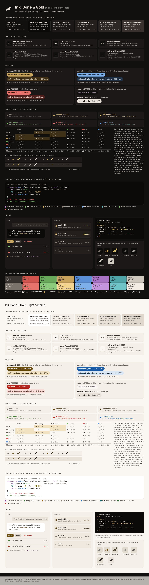

# color-01-ink-bone-gold - Ink, Bone & Gold

**The palette Huginn already has, finished.** Warm near-black ground, parchment
ink, one rune-gold accent. Nothing the owner already likes moves; the gaps the
brief names are filled: five surface tiers instead of two, three outline tiers,
a full semantic set (idle / working / attention / success / error / info) that is
brand-native instead of borrowed from the Electron tray, syntax tuned to a real
code ground, and a terminal layer (ANSI-16, tmux, VHS, CLI) that speaks the same
hex. The three tray states are one family at three lightness steps - dim stone,
the gold, the gold lit up - so a monochrome tray, a 16-colour terminal and a
colour-blind reader all tell them apart without hue; and four ANSI slots are
pinned to app tokens (brightRed = error, brightGreen = success, brightYellow =
attention, brightBlue = info), so the CLI's error is the app's error.

Files: `tokens.json` (every token with role, L*, contrast on its ground),
`swatches.html` (this sheet), `contrast.txt` (verbatim `tools/contrast.py` proof
for every pair plus the L*, hue and legacy-palette tables), `tray-sizes.png` (the
six tray icons at 22 and 16 px, dark and light bars, rendered with
`tools/render.mjs` and upscaled with hard pixels), `terminal/` (ANSI-16, Windows
Terminal, VHS, tmux, bash/PowerShell tables, the glyph, terminal mock and its
render).

## Intended uses

The default direction: the app (phone + desktop), the tray, the README, the VHS
demo and the CLI. It is a drop-in for `Theme.kt` because every existing hex is
either kept or given a tier name; the migration is a rename, not a redesign.

## Strengths

- Zero brand drift: ground, ink, accent, `inkMark`, `boneTile`, error and
  secondary are today's values. Everything shipped (icons, installer bitmap,
  README SVGs) stays valid.
- The warmest of the three: reads as parchment and candle-light, not as a code
  editor. The gold accent doubles as ANSI yellow and as the tmux/cursor colour,
  so the CLI is on-brand with a plain `\033[33m`.
- The state ladder is monochrome-first by construction: L* 54 / 69 / 86
  dark and 48 / 35 / 18 light in the app tokens; 49 / 69 / 86 (steps 20, 17) in
  ANSI-16 (brightBlack / yellow / brightYellow); 47 / 71 / 90 dark and
  61 / 34 / 9 light as monochrome tray tints at 45% /
  75% / 100%. All three ladders are checked by
  `build/check.py`.
- Every text pair is AA or better on every tier it is used on, including
  secondary text on dialogs, which the current `Muted` fails
  (#8A8177 is 3.84:1 on tier 3).
- The terminal's error *is* the app's error: brightRed `#E8736D` = `error`,
  brightGreen `#8CCB7B` = `stateSuccess`, brightYellow `#F3D58F` =
  `stateAttention`, brightBlue `#7DAFEA` = `stateInfo`.

## Weaknesses (honest)

- Gold is a warm hue and so are warning and attention. In the terminal `warn`
  and `attention` share the brightYellow slot (`#F3D58F`) and the accent is
  yellow (`#C8A45C`): the same hue, 17 L* apart. A
  CLI "warn" and a session that "needs you" are the same colour, told apart by
  bold and the word. If the owner wants a cold warning colour, that is direction 2.
- Light-scheme `stateAttention` (`#3A2A06`) is a very dark umber. It is
  17 L* from working as the rule demands, but in light mode
  "attention" reads as "darkest", not "brightest"; the badge dot and the word carry
  the meaning.
- The light-scheme primary darkens from #7A5A16 to `#6B4E10` so that idle (a
  4.56:1 grey, L* 48) and working (L* 35) sit
  12 L* apart. If the owner would rather keep #7A5A16, idle must
  become a dot-only colour (#8A8177, 3.58:1).
- `Ansi.kt` takes four edits, not three: brightYellow moves from #E3C169 to
  `#F3D58F` to make the 16-colour ladder (the syntax `number` keeps #E3C169).
- The lilac tertiary `#C9A3D2` is 9 degrees from
  the syntax `keyword` `#C495DC`. They never share a surface (code
  well vs list rows), but a reader who knows the editor may read the subagent
  marker as "a keyword colour".
- It is the least *new*: a reviewer who wants the overhaul to be visible from
  across the room will not see it in this palette; they will see it in the
  mark and the wordmark.

## Relation to the current mark and palette

Same mark, same `inkMark` #161310 on `boneTile` #E8E2DA, same ground. This is
the evolution; 02 and 03 are the departures.

## Every change from today's values

Every ratio below is computed by `build/readmes.py` from `build/spec.py`.

Dark scheme (Theme.kt `DarkColors`):

| token | today | here | why |
|---|---|---|---|
| background / surface | #12100F | #12100F | kept |
| onBackground / onSurface (Ink) | #E8E2DA | #E8E2DA | kept |
| surfaceContainerLow | Surface1 #1B1817 | #1B1817 | kept, named tier 1 |
| surfaceContainer | Surface2 #241F1D | #241F1D | kept, named tier 2 |
| surfaceContainerLowest | - | #0C0A09 | new tier 0: code wells and the terminal block sit *below* the page, the way a terminal does |
| surfaceContainerHigh | = Surface2 | #2D2725 | new tier 3: dialogs and menus were the same colour as cards |
| surfaceContainerHighest | - | #38312D | new tier 4: chips and fields on a dialog |
| onSurfaceVariant (Muted) | #8A8177 | #A39A8F | #8A8177 is 4.96:1 on the ground but 3.84:1 on tier 3 and 3.33:1 on tier 4: secondary text on a dialog failed AA. It survives as `stateIdle`. The new value is 4.60:1 on tier 4 |
| outline | #3A3431 | #7A736C | M3's outline is the 3:1 stroke (text fields); #3A3431 is 1.55:1. The old hex becomes `outlineVariant` |
| outlineVariant | #2A2523 | #3A3431 | decorative borders, today's outline |
| outlineHairline | - | #2A2523 | huginn-specific divider tier, today's outlineVariant |
| primary / onPrimary (Accent) | #C8A45C / #241C09 | #C8A45C / #241C09 | kept (7.16:1) |
| primaryContainer / on | Surface2 / Ink | #3E3117 / #EBD5A3 | a selected row or accent chip was a grey surface; now it carries the gold (8.80:1) |
| secondary / onSecondary | #7DAFEA / #0B1622 | #7DAFEA / #0B1622 | kept |
| secondaryContainer / on | - | #1E2F44 / #C6DCF5 | new; without them M3 falls back to its own purple |
| tertiary | - (M3 default pink #EFB8C8) | #C9A3D2 | a dusty lilac for subagent markers and graph series, 8.72:1 on the ground, >= 12 L* or >= 60 degrees from every state colour (checked) |
| error / onError | #E8736D / #2A0E0C | #E8736D / #2A0E0C | kept; `SOFT_VERB_ALPHA` 0.7 still yields #A85551 (3.69:1, a UI tint, not text) |
| errorContainer / on | - | #4A1F1C / #F6C7C3 | new, for banners and toasts |
| stateIdle | tray #7B8794 (blue-grey) | #8A8177 | the brand's stone, L* 54 |
| stateWorking | tray #7AA2F7 (blue) | #C8A45C | the accent: Huginn thinking is the gold eye; `PulseDot` already animates `primary` |
| stateAttention | tray #E0AF68 (amber) | #F3D58F | the gold lit up, L* 86, + badge dot; also ANSI brightYellow |
| stateSuccess | - | #8CCB7B | = ANSI brightGreen = syntax `string`; one green everywhere |
| stateError / stateInfo | - | = error / = secondary | aliases, so the tray and the chat never pick different reds; = ANSI brightRed / brightBlue |
| inkMark / boneTile | #161310 / #E8E2DA | #161310 / #E8E2DA | kept (14.38:1) |
| syntax comment | #8A8177 | #8F8679 | 5.51:1 on the new tier-0 code ground; the other seven classes are unchanged |

Light scheme (`LightColors`):

| token | today | here | why |
|---|---|---|---|
| background / onBackground | #FAF7F2 / #1B1817 | #FAF7F2 / #1B1817 | kept |
| surfaceContainer | surfaceVariant #EFE9E0 | #EFE9E0 | kept, named tier 2 |
| surfaceContainerLowest / Low / High / Highest | - | #FFFFFF / #F4EFE8 / #E8E1D7 / #E0D8CC | new tiers, one step each |
| onSurfaceVariant | #5C544B | #5C544B | kept (5.26:1 on tier 4) |
| outline | #D3CAC0 | #847B71 | the 3:1 stroke (3.89:1); the old hex becomes `outlineVariant`, hairline #E6DFD5 new |
| primary | #7A5A16 | #6B4E10 | one step darker so idle (L* 48) and working (L* 35) sit 12 L* apart; 7.22:1 as text |
| primaryContainer / on | - | #F1E3C2 / #3E2D06 | new |
| secondary | - (M3 default #625B71) | #1F5FA8 | `LightSyntax.function`, which already was the de-facto link blue |
| tertiary | - | #5F3D66 | the lilac, darkened (8.38:1) |
| error / onError | #B3261E / - | #B3261E / #FFFFFF | kept; containers #F9DBD7 / #5E1410 new |
| states | - | idle #777069, working #6B4E10, attention #3A2A06, success #3F7A33 | the ladder inverted: in light mode prominence is darkness (L* 48 / 35 / 18) |

Terminal (`mobile/core/.../ui/Ansi.kt` palette[0..15]): four edits to today's
sixteen - `yellow` #C7A24A becomes the accent #C8A45C exactly, `brightBlack`
#6B645D becomes `outline` #7A736C (4.06:1 instead of 3.26:1, so dim
tool output stays readable), `black` #3B3733 becomes `outlineVariant` #3A3431
(same intent: visible against the ground), and `brightYellow` #E3C169 becomes
`stateAttention` #F3D58F so the 16-colour ladder has a real top step
(#E3C169 was 10 L* from the accent). The other twelve slots are unchanged.

## Revision (after the creative director's review)

- `tertiary` was #A3BE8C, 0 L* and 6 degrees from `stateSuccess`: the subagent
  marker and the success dot were one green. Now #C9A3D2 / #5F3D66 (light),
  and `build/check.py` has a tertiary-vs-every-state rule (>= 12 L* or
  >= 60 degrees; neutrals by L* only) with the row printed on the sheet.
- `stateSuccess` #96C27E -> #8CCB7B, the existing brightGreen / `string` green,
  so one green serves app, syntax and terminal (slot pin).
- The 16-colour state ladder was 49 / 69 / 79 (a 10 L* top step, under the rule
  the README claimed). brightYellow is now `stateAttention` #F3D58F:
  49 / 69 / 86 (steps 20, 17), and the ladder is a generator rule.
- `cli-colors.ps1` mapped Error = DarkRed, Ok = DarkGreen (1.92:1 and
  4.09:1 on the default conhost). Both CLI tables now use the bright slots
  (ok = Green / 92, warn = Yellow / 93, error = Red / 91, muted = DarkGray / 90, accent = DarkYellow / 33), which are
  today's `huginn.ps1` colours, with every legacy palette's ratio in the header.
- Both CLI files are pure 7-bit ASCII (the generator refuses otherwise); the
  raven is built from escapes, gated on a UTF-8 locale / code page, with
  `H_GLYPH_ASCII` = `(o)==-` for the clients.
- The tmux glyph `▄▟▘` (a staircase, not a bird) is replaced by the ascii
  dimension's `◢▆█▀`; the tmux header now states the `Tc` override and the
  snippet ships a real 16-colour fallback instead of claiming every hex was a slot.
- Monochrome tray tints are 45% / 75% / 100% (L* 47 / 71 / 90),
  checked, and the sheet shows the six tray icons at 22 and 16 px.
- The swatch sheet's `huginn status` panel is drawn from the CLI slots (it had
  coloured `warn` with the accent) and the light mock's terminal block is the
  dark tier-0 well; the terminal mock lost its macOS chrome.
- This README is generated (`build/readmes.py`): the hand-typed "4.8:1 / 3.5:1"
  are now 4.96:1 / 3.33:1, by construction.
