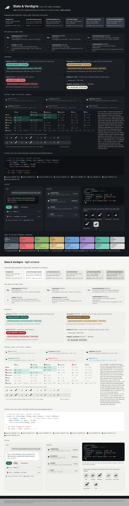

# color-02-slate-verdigris - Slate & Verdigris

**Night sky over oxidised bronze.** A cool slate ground (`#14171C`) with a
warm bone ink (`#E4E2DC`), one verdigris accent (`#5DBBA6`) - the patina on a
bronze raven, the green sheen on a live one - over a bronze secondary
(`#C9A775`) and a lilac tertiary. It is the direction where the overhaul is
*visible in colour*: the ground is no longer near-black-brown, the accent is no
longer gold, and yet the bone ink and the bronze keep it off the teal-on-charcoal
convention that half the dark themes share. The accent sits in the ANSI cyan
slot, so yellow stays free for warnings and the terminal's semantics are the
cleanest of the three.

Files: `tokens.json`, `swatches.html` -> `preview.png`, `contrast.txt` (verbatim
`tools/contrast.py` proof plus the L*, hue and legacy-palette tables),
`tray-sizes.png` (the six tray icons at 22 and 16 px via `tools/render.mjs`), `terminal/`.

## Intended uses

The whole product if the owner wants the overhaul seen in colour; strongest on
the desktop app and in the terminal, slightly less at night on the phone, where
the slate reads a touch cooler than the parchment direction.

## Strengths

- Modern without being generic: bone ink and bronze warmth on slate is not what
  Tokyo Night, Catppuccin or One Dark do.
- The cleanest terminal semantics: the accent (cyan) and warning (brightYellow)
  are different hues, 128 degrees apart; `ok` is a leaf green
  (`#A9C97E`, hue 86) 81 degrees from the verdigris, so git's greens and
  the accent never blur.
- Tray ladder L* 57 / 70 / 86 dark / 47 / 34 / 18 light; 50 / 70 / 86 (steps 20, 16) in
  ANSI-16; monochrome tints 48 / 71 / 90 / 61 / 35 / 11. Working (verdigris)
  and attention (pale bronze `#EFD3A0`) are opposed in temperature (cool vs
  warm) as well as 16 L* apart, which survives every colour-vision
  deficiency.
- The best raven story in the palette itself: iridescence, patina, bronze.
- Slot pins: brightRed `#E8767A` = `error`, brightGreen = `stateSuccess`,
  brightYellow = `stateAttention`, brightBlue = `stateInfo`.

## Weaknesses (honest)

- Furthest from what ships: every surface, `inkMark` #15181C and `boneTile`
  #E4E2DC move (2-4 units from #161310 / #E8E2DA; the owner may keep today's
  tile and only the app changes).
- It borders on the dark-dev-tool convention; only the bone ink and the bronze
  hold it off, and a future "let's make the ink pure white" would collapse it.
- The light primary `#175B50` is a pine green rather than a patina; the light
  scheme carries less of the story.
- `stateInfo` `#86B8E8` and working `#5DBBA6` are 3 L* apart and both cool
  (43 degrees); info is text-only and always has a word.
- In the terminal `warn` and `attention` share brightYellow (`#EFD3A0`): a
  stale device and a session that needs you are the same colour, bold and the
  word apart.
- The 16-colour CLI accent is brightCyan (`#7FD0BE` with the scheme installed,
  the lit verdigris) rather than the exact accent, because DarkCyan is only
  4.40:1 on the default conhost; the truecolor branch pins `#5DBBA6`.

## Relation to the current mark and palette

Same mark; the tile moves from #161310 / #E8E2DA to #15181C / #E4E2DC to sit in
the slate (optional). The gold is gone: the accent is the patina, the bronze
secondary is where the warmth went.

## Values

Dark: ground #14171C, ink #E4E2DC, tiers #0E1013 / #1B1F25 /
#22272E / #2A3038 / #343B44; onSurfaceVariant #9DA6AE
(4.58:1 on tier 4); outline #6F7983 (4.05:1); primary #5DBBA6 (7.80:1),
onPrimary #06201C (7.41:1); secondary #C9A775 (7.93:1); tertiary #C4A0D0
(7.94:1); error #E8767A (6.25:1); states idle #7F8992, working #5DBBA6,
attention #EFD3A0, success #A9C97E, info #86B8E8.

Light: ground #F5F5F1, ink #1A1D21; primary #175B50 (7.25:1); secondary
#7A5A2E; tertiary #5C3A63 (8.58:1); error #B3262E; states idle #677078,
working #175B50, attention #3A2A0A, success #2E7A4E, info #245FA5
(L* 47 / 34 / 18).

Terminal: `Ansi.kt` palette[0..15] is replaced wholesale by `terminal/slate-verdigris.ansi.json`;
the accent is `cyan` #5DBBA6, the cursor too.

## Revision (after the creative director's review)

- `stateSuccess` was #8FCBA3, a mint 27 degrees and 7 L* from the
  verdigris: the two most frequent dots in the session list were two teals. Now
  `#A9C97E` (hue 86, 81 degrees away), and the ANSI greens moved with it
  (green #86B36A, brightGreen #A9C97E = success); brightRed is now the app's
  `error` #E8767A (slot pin).
- `tertiary` #B9A3E3 was 51 degrees from `stateInfo`; now #C4A0D0 / #5C3A63,
  which clears the new tertiary rule against every state.
- brightYellow is `stateAttention` #EFD3A0 (was #EBC98A), so the ANSI ladder
  is 50 / 70 / 86 (steps 20, 16) and a generator rule.
- "the two hues are complementary" was wrong (verdigris hue 167, pale bronze
  hue 39: 128 degrees); it now says opposed in temperature, and the
  L* figures carry the claim.
- CLI: bright slots in both tables (ok = Green / 92, warn = Yellow / 93, error = Red / 91, muted = DarkGray / 90, accent = Cyan / 96),
  legacy ratios in the header, pure 7-bit ASCII, `H_GLYPH` / `H_GLYPH_ASCII`.
- tmux glyph `◢▆█▀` from ascii-03; `Tc` override; real 16-colour fallback.
- Monochrome tray 45% / 75% / 100% (L* 48 / 71 / 90), checked and shown at 22 / 16 px.
- Swatch `huginn status` panel from the CLI slots; light mock's terminal is the
  dark well; terminal mock without macOS chrome; README generated.
