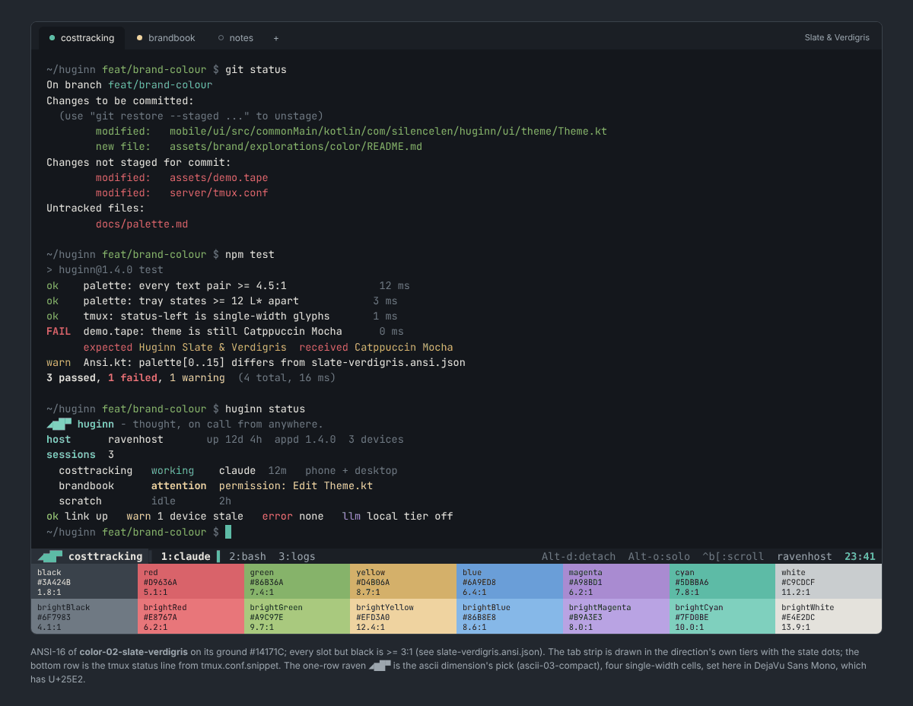

# Slate & Verdigris - terminal layer

The CLI, tmux, the VHS demo and the app's own terminal grid (`mobile/core/.../ui/Ansi.kt`)
all read this one ANSI-16 palette. Ground `#14171C` and foreground `#E4E2DC`
are the app's `background` / `onBackground`; the brand accent sits in the **cyan** slot
(`#5DBBA6`) and is also the cursor, so a plain `\033[36m`
is on-brand without truecolor. Four slots are *pinned* to app tokens (rightmost column), so the
CLI, tmux and the app never show two different reds: the terminal's error is the app's error.

| slot | hex | on ground | L* | pinned to |
|---|---|---|---|---|
| black | `#3A424B` | 1.76:1 | 28 | |
| red | `#D9636A` | 5.08:1 | 57 | |
| green | `#86B36A` | 7.42:1 | 68 | |
| yellow | `#D4B06A` | 8.74:1 | 74 | |
| blue | `#6A9ED8` | 6.41:1 | 64 | |
| magenta | `#A98BD1` | 6.24:1 | 63 | |
| cyan | `#5DBBA6` | 7.80:1 | 70 | |
| white | `#C9CDCF` | 11.22:1 | 82 | |
| brightBlack | `#6F7983` | 4.05:1 | 50 | |
| brightRed | `#E8767A` | 6.25:1 | 63 | = `error` |
| brightGreen | `#A9C97E` | 9.70:1 | 77 | = `stateSuccess` |
| brightYellow | `#EFD3A0` | 12.40:1 | 86 | = `stateAttention` |
| brightBlue | `#86B8E8` | 8.58:1 | 73 | = `stateInfo` |
| brightMagenta | `#B9A3E3` | 8.05:1 | 71 | |
| brightCyan | `#7FD0BE` | 9.98:1 | 78 | |
| brightWhite | `#E4E2DC` | 13.87:1 | 90 | |

cursor `#5DBBA6` - selection `#2A3F3C`.

States as ANSI slots: idle = brightBlack, working = cyan, attention = brightYellow, success = brightGreen, error = brightRed, info = brightBlue.
The 16-colour state ladder is brightBlack L* 50 -> cyan L* 70 -> brightYellow L* 86
(steps 20, 16; the rule is >= 12, checked by `build/check.py`).

## The CLI's five colours

`cli-colors.sh` / `cli-colors.ps1` are pure 7-bit ASCII (they are inlined into `client/huginn.sh`
and `huginn.ps1`, which must stay ASCII) and carry two branches. The 16-colour branch inherits
the user's palette, so it uses the **bright** slots - the dark red of every default palette is
under 2:1 on its own ground - and these are the colours `huginn.ps1` prints today. The ratios on
the legacy palettes the branch must survive (minimum 3:1):

| semantic | slot | SGR | ConsoleColor | Huginn scheme | conhost | powershell-5.1 | campbell | xterm |
|---|---|---|---|---|---|---|---|---|
| ok | brightGreen | 92 | Green | `#A9C97E` 9.7:1 | `#00FF00` 15.3:1 | `#00FF00` 11.0:1 | `#16C60C` 8.5:1 | `#00FF00` 15.3:1 |
| warn | brightYellow | 93 | Yellow | `#EFD3A0` 12.4:1 | `#FFFF00` 19.6:1 | `#FFFF00` 14.1:1 | `#F9F1A5` 16.9:1 | `#FFFF00` 19.6:1 |
| error | brightRed | 91 | Red | `#E8767A` 6.2:1 | `#FF0000` 5.3:1 | `#FF0000` 3.8:1 | `#E74856` 5.1:1 | `#FF0000` 5.3:1 |
| muted | brightBlack | 90 | DarkGray | `#6F7983` 4.1:1 | `#808080` 5.3:1 | `#808080` 3.8:1 | `#767676` 4.3:1 | `#7F7F7F` 5.2:1 |
| accent | brightCyan | 96 | Cyan | `#7FD0BE` 10.0:1 | `#00FFFF` 16.7:1 | `#00FFFF` 12.1:1 | `#61D6D6` 11.3:1 | `#00FFFF` 16.7:1 |

Grounds: conhost `#000000`, powershell-5.1 `#012456`, campbell `#0C0C0C`, xterm `#000000`. PowerShell 5.1's console
remaps DarkYellow to `#EEEDF0`, so an accent in slot 33 shows there as near-white (legible, not
gold). For `accent`, the truecolor branch pins the ember `#5DBBA6` itself, which has no ANSI slot (the yellow slot is an amber so git stays yellow).

## The one-row raven

The tmux segment and the CLI banner use the ascii dimension's pick, `◢▆█▀`
([`ascii-03-compact/raven-1line-a.txt`](../../../ascii/ascii-03-compact/)): tail wedge, body,
raised head, bill; four single-width cells. `▗▆█▀` is its fallback for fonts without
Geometric Shapes (U+25E2). `(o)==-` is the 7-bit form the clients print: the head row of
the help-screen raven already in `huginn.sh`. `glyph.txt` lists the three, one block each, and
passes `tools/asciicheck.py`. (The colour dimension's own earlier three-cell glyph was dropped:
it rendered as a staircase, and two dimensions must not ship two ravens for one tmux line.)

## Files

| file | consumer |
|---|---|
| `slate-verdigris.ansi.json` | source of truth; `Ansi.kt` palette[0..15], any emulator importer |
| `slate-verdigris.windows-terminal.json` | paste into Windows Terminal `settings.json` -> `schemes` |
| `slate-verdigris.vhs.json`, `slate-verdigris.tape.snippet` | the `Set Theme` line for `assets/demo.tape` |
| `tmux.conf.snippet` | status line for `server/tmux.conf` (truecolor block with the `Tc` override, and a 16-colour fallback) |
| `cli-colors.sh`, `cli-colors.ps1` | the five semantic colours and the glyph for `client/huginn.sh`, `server/bin/huginn-status`, `client/huginn.ps1` |
| `glyph.txt` | the one-row raven: Unicode, block-only, ASCII |
| `mock.html` -> `preview.png` | the render above: git status, a test run, `huginn status`, the tmux line, the 16 slots |
