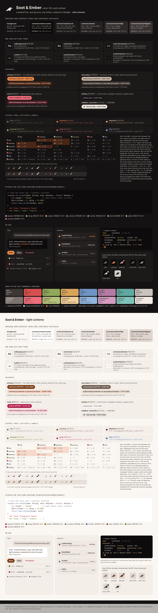

# color-03-soot-ember - Soot & Ember

**A banked fire.** Soot ground (`#141212`), warm bone ink, and one ember
(`#E58A4C`) that is the only saturated thing on the screen: the raven's eye
catching firelight. Around it, warm ash for the second voice (`#C7B5A3`), an
olive success, a crimson error, and a cream-amber attention. In daylight the
ember cools to oxblood-brown (`#7A3E14`) and the error to crimson (`#B01C4C`).
Restrained by rule: everything but the ember is a near-neutral or a muted
tool colour.

Files: `tokens.json`, `swatches.html` -> `preview.png`, `contrast.txt`, `tray-sizes.png`
(the six tray icons at 22 and 16 px via `tools/render.mjs`), `terminal/`.

## Intended uses

The desktop app, the installer and the README hero, where one hot accent on dark
has room to be dramatic; less suited to Android notification and permission
surfaces, where orange already means "warning" to the OS and the user.

## Strengths

- The most distinctive and the most "brand" of the three: unmistakably the
  raven's eye in firelight.
- The warmest ground, keeping the "terminal that does not look like a terminal
  emulator" intent of `Theme.kt`.
- Tray ladder L* 52 / 66 / 85 dark / 47 / 33 / 17 light; 49 / 71 / 85 (steps 22, 14) in ANSI-16;
  monochrome tints 48 / 72 / 91 / 61 / 34 / 9. Attention `#F2CF96` is a
  cream-amber flash 19 L* above the ember.
- Olive success (`#B5C27A`, hue 71) and crimson error (`#EE6E7C`, hue 353)
  separate by hue and by 14 L*.
- The CLI really shows the ember: the truecolor branch pins `#E58A4C` for
  `H_ACCENT` / `$HuginnSgr.Accent`; the 16-colour branch falls back to the amber
  yellow slot.

## Weaknesses (honest)

- **Main risk: the ember is Claude's colour.** `#E58A4C` (hue 24) on near-black
  is the same terracotta-on-dark family as the host product's own accent. For a
  Claude Code client, an ember-on-soot app and CLI can read as wearing the host's
  identity rather than having one. The direction keeps the ember on purpose -
  moving it to amber would make it a hotter copy of direction 1 - and names the
  risk here and in the comparison table.
- Ember (hue 24, L* 66) and error (`#EE6E7C`, hue 353, L* 62) are
  31 degrees and 4 L* apart: error can never be a pure red here and
  always comes with a word or an icon.
- The ember has no ANSI slot: the yellow slot is an amber (`#D9A45A`) so git still
  reads as yellow; the ember lives in the cursor, the tmux segment and the
  truecolor CLI branch only.
- Orange is a warning colour in every OS; a working session glowing ember reads
  as "something is wrong" until learned.
- Light scheme: working `#7A3E14` (hue 25) and error `#B01C4C` (hue 341) are
  44 degrees and 6 L* apart; better than before, still two dark warm
  dots that need their words.
- `inkMark` #171312 / `boneTile` #EAE3DC move a few units from #161310 / #E8E2DA, so
  tile rasters are rebuilt (or today's tile is kept).
- In the terminal `warn` and `attention` share brightYellow (`#F2CF96`).

## Relation to the current mark and palette

Same mark on a slightly warmer tile. The gold is replaced by the ember; the
parchment ink stays. Of the three it is the one that most changes what the
product *feels* like without changing what it *is*.

## Values

Dark: ground #141212, ink #EAE3DC, tiers #0D0B0B / #1C1919 /
#242020 / #2D2828 / #383131; onSurfaceVariant #A39A94;
outline #7C736E (4.03:1); primary #E58A4C (7.17:1), onPrimary #2E1207
(6.69:1); secondary #C7B5A3; tertiary #C29ECF (8.08:1, a dusty
lavender, >= 12 L* or >= 60 degrees from every state); error #EE6E7C
(6.36:1); states idle #847B76, working #E58A4C, attention #F2CF96,
success #B5C27A, info #8FB4DE.

Light: ground #FAF6F2, ink #1E1917; primary #7A3E14 (7.73:1, 5.77:1 on
tier 4); secondary #6B5A4C; tertiary #633F7A (7.74:1); error #B01C4C
(6.27:1); states idle #776E69, working #7A3E14, attention #4A1A0A,
success #5A7A1E, info #2A5F9E (L* 47 / 33 / 17).

Terminal: `Ansi.kt` palette[0..15] replaced by `terminal/soot-ember.ansi.json`; yellow is the amber
#D9A45A, brightYellow is `stateAttention` #F2CF96, the cursor is the ember #E58A4C.

## Revision (after the creative director's review)

- The ANSI ladder was 49 / 71 / 77 with working and attention the same amber
  (6 L*, 1 degree); brightYellow is now `stateAttention` `#F2CF96` (the
  app token moved from #F8D9B8 to it): 49 / 71 / 85 (steps 22, 14), a generator rule, and
  the swatch sheet's `huginn status` panel now uses the ANSI slots like the mock.
- The ember is in the CLI: `cli_truecolor_hex()` pins `#E58A4C` for the accent in
  the truecolor branch (it was the amber slot in every branch while the README
  said otherwise).
- Light working / error were #86351F and #B81E3F (26 degrees, 7 L*): now
  `#7A3E14` and `#B01C4C` (44 degrees); light tertiary moved from #7B2D2D (a third
  dark red) to `#633F7A`.
- Dark tertiary was #D19A94, a salmon 6 L* from error; now `#C29ECF`, and
  the restraint claim holds again: the ember is the only saturated warm.
- The Claude-terracotta collision is owned as the main risk (above and in the
  root comparison table) rather than moved to amber.
- CLI: bright slots (ok = Green / 92, warn = Yellow / 93, error = Red / 91, muted = DarkGray / 90, accent = DarkYellow / 33), legacy ratios,
  pure ASCII, `H_GLYPH` / `H_GLYPH_ASCII`; tmux glyph `◢▆█▀`, `Tc` override and a
  real 16-colour fallback; monochrome tray 45% / 75% / 100%
  (L* 48 / 72 / 91) checked and shown at 22 / 16 px; light mock's terminal is the dark
  well; terminal mock without macOS chrome; README generated.
