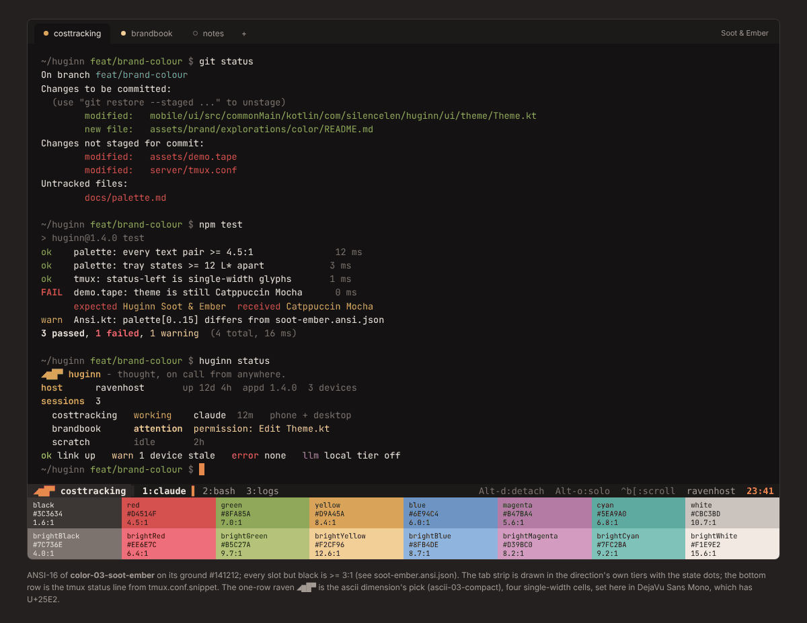

# Soot & Ember - terminal layer

The CLI, tmux, the VHS demo and the app's own terminal grid (`mobile/core/.../ui/Ansi.kt`)
all read this one ANSI-16 palette. Ground `#141212` and foreground `#EAE3DC`
are the app's `background` / `onBackground`; the brand accent sits in the **yellow** slot
(`#D9A45A`) and is also the cursor, so a plain `\033[33m`
is on-brand without truecolor. Four slots are *pinned* to app tokens (rightmost column), so the
CLI, tmux and the app never show two different reds: the terminal's error is the app's error.

| slot | hex | on ground | L* | pinned to |
|---|---|---|---|---|
| black | `#3C3634` | 1.57:1 | 23 | |
| red | `#D4514F` | 4.52:1 | 52 | |
| green | `#8FA85A` | 7.04:1 | 65 | |
| yellow | `#D9A45A` | 8.36:1 | 71 | |
| blue | `#6E94C4` | 5.95:1 | 60 | |
| magenta | `#B47BA4` | 5.61:1 | 59 | |
| cyan | `#5EA9A0` | 6.81:1 | 64 | |
| white | `#CBC3BD` | 10.74:1 | 79 | |
| brightBlack | `#7C736E` | 4.03:1 | 49 | |
| brightRed | `#EE6E7C` | 6.36:1 | 62 | = `error` |
| brightGreen | `#B5C27A` | 9.74:1 | 76 | = `stateSuccess` |
| brightYellow | `#F2CF96` | 12.57:1 | 85 | = `stateAttention` |
| brightBlue | `#8FB4DE` | 8.67:1 | 72 | = `stateInfo` |
| brightMagenta | `#D39BC0` | 8.20:1 | 70 | |
| brightCyan | `#7FC2BA` | 9.18:1 | 74 | |
| brightWhite | `#F1E9E2` | 15.55:1 | 93 | |

cursor `#E58A4C` - selection `#452A1E`.

States as ANSI slots: idle = brightBlack, working = yellow, attention = brightYellow, success = brightGreen, error = brightRed, info = brightBlue.
The 16-colour state ladder is brightBlack L* 49 -> yellow L* 71 -> brightYellow L* 85
(steps 22, 14; the rule is >= 12, checked by `build/check.py`).

## The CLI's five colours

`cli-colors.sh` / `cli-colors.ps1` are pure 7-bit ASCII (they are inlined into `client/huginn.sh`
and `huginn.ps1`, which must stay ASCII) and carry two branches. The 16-colour branch inherits
the user's palette, so it uses the **bright** slots - the dark red of every default palette is
under 2:1 on its own ground - and these are the colours `huginn.ps1` prints today. The ratios on
the legacy palettes the branch must survive (minimum 3:1):

| semantic | slot | SGR | ConsoleColor | Huginn scheme | conhost | powershell-5.1 | campbell | xterm |
|---|---|---|---|---|---|---|---|---|
| ok | brightGreen | 92 | Green | `#B5C27A` 9.7:1 | `#00FF00` 15.3:1 | `#00FF00` 11.0:1 | `#16C60C` 8.5:1 | `#00FF00` 15.3:1 |
| warn | brightYellow | 93 | Yellow | `#F2CF96` 12.6:1 | `#FFFF00` 19.6:1 | `#FFFF00` 14.1:1 | `#F9F1A5` 16.9:1 | `#FFFF00` 19.6:1 |
| error | brightRed | 91 | Red | `#EE6E7C` 6.4:1 | `#FF0000` 5.3:1 | `#FF0000` 3.8:1 | `#E74856` 5.1:1 | `#FF0000` 5.3:1 |
| muted | brightBlack | 90 | DarkGray | `#7C736E` 4.0:1 | `#808080` 5.3:1 | `#808080` 3.8:1 | `#767676` 4.3:1 | `#7F7F7F` 5.2:1 |
| accent | yellow | 33 | DarkYellow | `#D9A45A` 8.4:1 | `#808000` 5.0:1 | `#EEEDF0` 13.0:1 | `#C19C00` 7.5:1 | `#CDCD00` 12.3:1 |

Grounds: conhost `#000000`, powershell-5.1 `#012456`, campbell `#0C0C0C`, xterm `#000000`. PowerShell 5.1's console
remaps DarkYellow to `#EEEDF0`, so an accent in slot 33 shows there as near-white (legible, not
gold). For `accent`, the truecolor branch pins the ember `#E58A4C` itself, which has no ANSI slot (the yellow slot is an amber so git stays yellow).

## The one-row raven

The tmux segment and the CLI banner use the ascii dimension's pick, `◢▆█▀`
([`ascii-03-compact/raven-1line-a.txt`](../../../ascii/ascii-03-compact/)): tail wedge, body,
raised head, bill; four single-width cells. `▗▆█▀` is its fallback for fonts without
Geometric Shapes (U+25E2). `(o)==-` is the 7-bit form the clients print: the head row of
the help-screen raven already in `huginn.sh`. `glyph.txt` lists the three, one block each, and
passes `tools/asciicheck.py`. (The colour dimension's own earlier three-cell glyph was dropped:
it rendered as a staircase, and two dimensions must not ship two ravens for one tmux line.)

## Files

| file | consumer |
|---|---|
| `soot-ember.ansi.json` | source of truth; `Ansi.kt` palette[0..15], any emulator importer |
| `soot-ember.windows-terminal.json` | paste into Windows Terminal `settings.json` -> `schemes` |
| `soot-ember.vhs.json`, `soot-ember.tape.snippet` | the `Set Theme` line for `assets/demo.tape` |
| `tmux.conf.snippet` | status line for `server/tmux.conf` (truecolor block with the `Tc` override, and a 16-colour fallback) |
| `cli-colors.sh`, `cli-colors.ps1` | the five semantic colours and the glyph for `client/huginn.sh`, `server/bin/huginn-status`, `client/huginn.ps1` |
| `glyph.txt` | the one-row raven: Unicode, block-only, ASCII |
| `mock.html` -> `preview.png` | the render above: git status, a test run, `huginn status`, the tmux line, the 16 slots |
