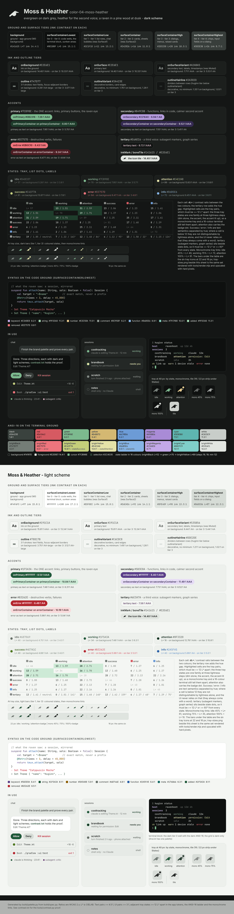

# color-04-moss-heather - Moss & Heather

**A raven in a pine wood at dusk.** The owner's ask after round 4 went up: "a new
theme, more evergreens, purples, dark greys". A dark grey ground with a breath of
green in it (`#141615`), cool bone ink (`#E2E6E1`), moss (`#7CB98E`) as the one
accent, and heather (`#B49CDB`) as the second voice for functions, links in code
and the CLI's headings. Needs-you is the moss lit to a pale yellow-green
(`#E4E2A8`), success is a lime (`#C4CF7A`), error a coral (`#EE757D`), the third
voice a dusty rose (`#E6AEC6`). In daylight the moss deepens to evergreen
(`#1F5A3A`) and the heather to a royal purple (`#5B3E8A`).

Built from the same `build/spec.py` as the other three and proved by the same
`build/check.py`: every text pair >= 4.5:1, UI >= 3:1, the tray ladder idle /
working / attention at L* 57 / 70 / 89, the ANSI ladder brightBlack / green /
brightYellow at 51 / 70 / 89, monochrome tray 49 / 72 / 91, every ANSI slot but
black >= 3:1 on the ground, the CLI's 16-colour slots >= 3:1 on conhost,
PowerShell 5.1, Campbell and xterm. `contrast.txt` is the proof line by line.

Files: `tokens.json`, `swatches.html` -> `preview.png`, `contrast.txt`,
`tray-sizes.png`, `terminal/` (`moss-heather.ansi.json`, Windows Terminal, VHS,
tmux, `cli-colors.sh` / `.ps1`, the glyph, `mock.html` -> `preview.png`).

## Where the colours go

| role | dark | light | note |
|---|---|---|---|
| ground / ink | `#141615` / `#E2E6E1` | `#F4F6F3` / `#191C1A` | dark grey with 2 units of green in it; the ink is cool bone |
| primary, the accent | moss `#7CB98E` | evergreen `#1F5A3A` | 7.95:1 on the dark ground; the raven eye, links, buttons, the tmux segment, the cursor |
| secondary | heather `#B49CDB` | `#5B3E8A` | functions, links in code, `stateInfo`'s neighbour; the CLI's heading colour (brightMagenta) |
| tertiary | rose `#E6AEC6` | plum `#6E3A7A` | subagent markers; >= 12 L* or >= 60 degrees from every state |
| error | coral `#EE757D` | `#B3262E` | brightRed |
| idle / working / attention | `#848C87` / `#7CB98E` / `#E4E2A8` | `#687069` / `#1F5A3A` / `#0F3320` | the tray ladder; attention is the moss lit, which lands in the yellow-green |
| success / info | lime `#C4CF7A` / `#86B5E6` | `#4E7A1C` / `#2A5FA5` | brightGreen / brightBlue |

## Strengths

- Does exactly what was asked: the evergreen is the brand colour, the purple is
  everywhere code and links are, and the greys are cool and quiet.
- The bone raven on the green-grey ground is the handsomest of the four hero
  panels; the negative-mark tile in moss reads as a leaf-and-bird at 16.
- Unmistakably not the host product's palette and not a stock dark theme.

## Trade-offs, honestly

- **Green now means two things.** Working is moss and success is lime: 68
  degrees and 11 L* apart, told apart in the sheet's state table, but a session
  that is running and a test that passed are both "green" at a glance. The other
  three directions keep success as the only green.
- **The purple never reaches the tray.** Heather is the second voice, so it
  appears in code, links and the CLI headings, never in a state colour; if the
  owner wants purple in the tray it would have to replace the moss as the accent,
  which inverts the ask.
- **Attention is a highlighter.** The lit moss lands at `#E4E2A8`, a pale
  yellow-green; it passes the ladder and reads "lit", but next to the lime
  success it is the least distinct needs-you of the four.
- The CLI's accent slot is brightMagenta (the moss on the green slot fails 3:1
  on the PowerShell 5.1 ground at 2.94), so `huginn status` headings are heather
  in a 16-colour terminal and moss only in truecolor.

## Migration

The same list as the root README. Rasters regenerate (tile ink and bone move:
`#141615` / `#E2E6E1`); `Ansi.kt` takes `terminal/moss-heather.ansi.json`
wholesale; `TrayIcons.kt` takes the three state tokens; `generate.sh`'s
`wizard.bmp` ground becomes `#141615`.
