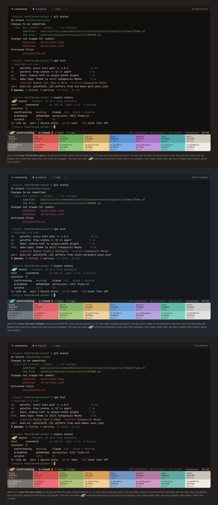

# The terminal layer

One ANSI-16 palette per direction, derived from the same tokens as the app, so
the CLI (`huginn status`, the reconnect messages), tmux on the host, the VHS demo
GIF, the app's own terminal grid (`mobile/core/.../ui/Ansi.kt`) and a Windows
Terminal profile all show the same ground, the same ink and the same accent.
The files live beside each direction so that a direction stays self-contained:

| direction | folder | accent slot | files |
|---|---|---|---|
| Ink, Bone & Gold | [`../color-01-ink-bone-gold/terminal/`](../color-01-ink-bone-gold/terminal/) | yellow | `ink-bone-gold.ansi.json`, `.windows-terminal.json`, `.vhs.json`, `.tape.snippet`, `tmux.conf.snippet`, `cli-colors.sh`, `cli-colors.ps1`, `glyph.txt`, `mock.html`, `preview.png` |
| Slate & Verdigris | [`../color-02-slate-verdigris/terminal/`](../color-02-slate-verdigris/terminal/) | cyan | `slate-verdigris.ansi.json`, `.windows-terminal.json`, `.vhs.json`, `.tape.snippet`, `tmux.conf.snippet`, `cli-colors.sh`, `cli-colors.ps1`, `glyph.txt`, `mock.html`, `preview.png` |
| Soot & Ember | [`../color-03-soot-ember/terminal/`](../color-03-soot-ember/terminal/) | yellow (an amber; the ember #E58A4C is the cursor, the tmux segment and the truecolor CLI accent) | `soot-ember.ansi.json`, `.windows-terminal.json`, `.vhs.json`, `.tape.snippet`, `tmux.conf.snippet`, `cli-colors.sh`, `cli-colors.ps1`, `glyph.txt`, `mock.html`, `preview.png` |

## Rules every palette meets

- `background` / `foreground` are the direction's `background` / `onBackground`.
- Every slot except `black` is >= 3:1 against the ground (most are >= 4.5:1),
  so git, test runners and `ls` stay readable; the exact ratios are in each
  `*.ansi.json` and at the bottom of each terminal mock.
- `black` is the direction's `outlineVariant`: visible against the ground
  (about 1.6:1) so black-on-ground output is not lost, dark enough to be black
  on a coloured background. `brightBlack` is `outline` (about 4:1), the colour
  of dim text, which is the slot most themes get wrong.
- Red / green / yellow are tool colours first: the brand accent is never put in
  the red or green slot.
- **Slot pins**: brightRed = `error`, brightGreen = `stateSuccess`, brightYellow =
  `stateAttention`, brightBlue = `stateInfo`, in every direction, by rule.
- **The state ladder in 16 colours** (brightBlack -> accent slot -> brightYellow)
  has steps >= 12 L*: Ink, Bone & Gold 49 / 69 / 86 (steps 20, 17); Slate & Verdigris 50 / 70 / 86 (steps 20, 16); Soot & Ember 49 / 71 / 85 (steps 22, 14).
- The CLI's five semantic uses map to slots: ok = brightGreen, warn =
  brightYellow, error = brightRed, muted = brightBlack, accent = the
  direction's accent slot (yellow for 01 and 03, brightCyan for 02). The bash
  and PowerShell tables carry a 16-colour branch (inherits the user's terminal
  palette, the right default for a CLI, hence the *bright* slots: every default
  palette's dark red is under 2:1 on its own ground) and a truecolor branch
  (pins the brand hex; for 03 that is the ember itself), both behind the same
  TTY / `NO_COLOR` rules `server/bin/huginn-status` already follows. Both files
  are pure 7-bit ASCII because they are inlined into `client/huginn.sh` and
  `huginn.ps1`.

## The one-row raven

The tmux left segment and the CLI's first line carry the ascii dimension's pick,
`◢▆█▀` (U+25E2 U+2586 U+2588 U+2580: tail wedge, body, raised head, bill), from
[`ascii-03-compact`](../../ascii/ascii-03-compact/). `▗▆█▀` is its fallback for
fonts without Geometric Shapes; `(o)==-` is the 7-bit form the clients print (the
head row of the help-screen raven already in `huginn.sh`). Each `glyph.txt` lists
the three and passes `tools/asciicheck.py`; `cli-colors.sh` / `.ps1` expose them as
`H_GLYPH` / `H_GLYPH_BLOCK` / `H_GLYPH_ASCII` and `$HuginnGlyph` / `$HuginnGlyphBlock` /
`$HuginnGlyphAscii`, choosing by locale or code page. Separators in the tmux line
are `▌` (U+258C); no powerline glyphs, which are private-use and often missing.
(The colour dimension's earlier `▄▟▘` was dropped after review: at 13 px it is a
two-step staircase, and two dimensions must not ship two ravens for one line.)

## Installing one direction

- **Windows Terminal**: paste `<slug>.windows-terminal.json` into `settings.json`
  under `"schemes"` and set the profile's `"colorScheme"` to its `name`.
- **VHS**: replace `Set Theme "Catppuccin Mocha"` in `assets/demo.tape` with the
  one line in `<slug>.tape.snippet`.
- **tmux on the host**: replace the `status-left` line in `server/tmux.conf`
  with the top block of `tmux.conf.snippet`. Truecolor needs
  `set -g default-terminal "tmux-256color"` **and** `set -as terminal-overrides ",*:Tc"`
  (without the override tmux rounds hex to the 256-colour cube); the commented
  block at the bottom is the 16-colour fallback with ANSI names only.
- **CLI**: inline `cli-colors.sh` in `client/huginn.sh` and `server/bin/huginn-status`;
  inline `cli-colors.ps1` in `client/huginn.ps1`.
- **The app's terminal grid**: copy `ansi16` from `<slug>.ansi.json` into
  `Ansi.kt` `palette[0..15]`.

Each `mock.html` is an HTML `<pre>` with spans in the ANSI colours: a `git
status`, a test run with a failure, `huginn status` with the one-row raven, the
tmux status line and the sixteen slots with their ratios, in a tab strip drawn
with the direction's own surface tiers. `preview.png` beside it is that page
rendered at 1200 wide; the sheet above is the three stacked.
