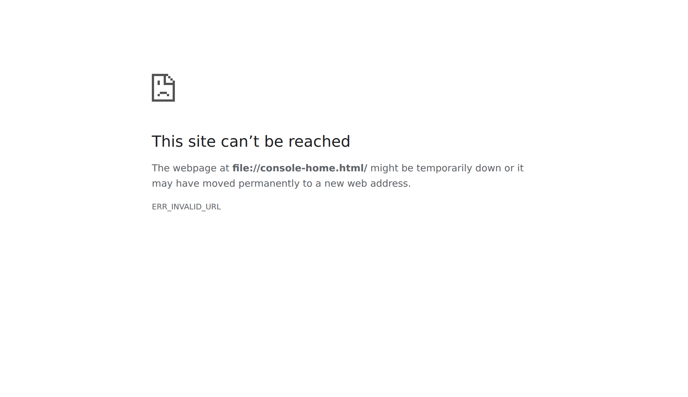

# The console

The console is a full-screen, keyboard-driven view of Huginn in your terminal: your sessions,
chats, projects, rounds, devices, usage, archive and huginn core, with what needs you at the top.
It opens when you type `huginn` with no arguments in a terminal.

```bash
huginn              # opens the console in an interactive terminal
huginn console      # opens it by name
```

Every `huginn <verb>` keeps working as before; the console is another way in, not a replacement.
Each screen names the command that does the same thing at the bottom (`same as: huginn devices`).



## What it needs

- **huginn core 2.3 or later, installed and running** on this computer. The console gets all its
  data through huginn core, so huginn core must also be paired with your server (see
  [Install the clients](../install/clients.md)).
- **An interactive terminal.** Both standard input and standard output must be a terminal, and
  `TERM` must not be `dumb`.
- **SSH to the server**, only for attaching to sessions (the `Host huginn` entry, or the alias in
  `HUGINN_HOST`). Without it, everything else works and attaching says to run `huginn setup ssh`.

The console is not available on Termux, where huginn core does not run.

### When huginn core is not answering

If huginn core is installed but not running, the console opens on a short screen instead:

| Key | Action |
|---|---|
| `s` | Start huginn core (`huginn core start`). |
| `i` | Set it up to start at boot (`huginn core install`). |
| `a` | Attach to the `main` session anyway, over SSH. |
| `q` | Quit. |

If huginn core runs but cannot reach the server, the home screen says why, and suggests
`huginn core pair --url https://<host>:8787` when huginn core is not paired yet.

## Attach to main instead

Plain `huginn` attaches to the `main` session, as it does without the console, when any of these
is true:

- `HUGINN_CONSOLE=0` is set (put it in your shell profile to make it permanent);
- its input or output is piped or redirected, as in a script;
- `TERM` is `dumb`;
- huginn core is not installed, or is older than 2.3.

`huginn main` always attaches to `main`, whatever these settings are.

```bash
export HUGINN_CONSOLE=0          # bash, in ~/.bashrc
```

```powershell
$env:HUGINN_CONSOLE = '0'        # PowerShell, in $PROFILE
```

## The screen

The top line shows the one-row raven and `huginn`, the screen you are on, and on the right the
server's name, the huginn core version and the connection:

| Word | Meaning |
|---|---|
| `live` | Connected; the screen updates as things change on the server. |
| `reconnecting…` | The update stream dropped; it reconnects every 3 seconds. What is on screen stays. |
| `huginn unreachable` | huginn core runs, but cannot reach the server. |
| `core not answering` | huginn core is not running. |

The raven reads `(!>` while any session needs you. The bottom two lines list the keys for the
current screen, then either the equivalent command, a kept filter, or the result of your last
action.

## Screens

The home screen shows the raven (when the window has room), the server and how many devices are
online, the sessions that need you, and one line per section with a summary. Press a number to
jump to a section from anywhere.

| Key | Screen | What it shows | Same as |
|---|---|---|---|
| `1` | Sessions | Every session outside a project, those that need you first, with its state, title, model and last activity. The selected session's details below: attached devices, context used, queued messages, and its last lines. | `huginn ls` |
| `2` | Chats | Ask and act conversations, the same ones the apps show ([Chats](chats.md)). | the apps |
| `3` | Projects | Each project with its members, how many are busy and how many wait; `Enter` opens its dashboard ([Projects](projects.md)). | `huginn projects` |
| `4` | Rounds | Scheduled rounds, their state and last run ([Rounds](rounds.md)). | `huginn rounds` |
| `5` | Devices | This computer (available to Huginn or not, name, scope), then every device, online first ([Devices](devices.md)). | `huginn devices` |
| `6` | Usage | Each Claude account's usage windows as bars, with reset times, held sessions and the last decision ([Usage limits](usage-limits.md)). | `huginn headroom` |
| `7` | Archive | Archived sessions, ready to revive ([Sessions](sessions.md#archive-huginn-archive)). | `huginn archive` |
| `8` | Settings | How this terminal is set up (what plain `huginn` opens, Unicode or 7-bit, colour), this computer as a device, and the huginn core pairing. Read-only; alerts and limits are set in the apps. | `huginn core status` |
| `9` | Core | huginn core (version, pairing, tray, this device) and the server (daemon and Claude Code versions, uptime, load, disk). | `huginn core status` |
| `?` | Help | Keys and the state marks. | `huginn help` |

States use the same marks as everywhere else in Huginn, always with a word and never by colour
alone:

| Mark | 7-bit | State |
|---|---|---|
| `●` | `*` | working |
| `▲` | `!` | needs you |
| `○` | `o` | waiting |
| `◦` | `-` | shell |
| `■` | `+` | ok |
| `×` | `x` | error |

## Keys

### Everywhere

| Key | Action |
|---|---|
| `↑` `↓` or `k` `j` | Move. `PgUp`/`PgDn` move ten rows; `Home`/`g` and `End`/`G` go to the first and last. |
| `Enter`, `→` or `l` | Open the selected item, or attach to the selected session. |
| `Esc`, `Backspace`, `←` or `h` | Back. On a screen with a kept filter, `Esc` clears the filter first. |
| `1`–`9` | Jump to a section. |
| `/` | Filter the list on screen. |
| `:` | The palette: go to anything, attach, or run any `huginn` verb. |
| `r` | Refresh now. |
| `Ctrl-L` | Redraw the screen. |
| `?` | Help. |
| `q` or `Ctrl-C` | Quit. |

### On each screen

| Screen | Keys |
|---|---|
| Sessions | `Enter` or `a` attach · `S` attach and detach the other devices (solo) · `n` new session (name it, then it attaches) · `s` send one line to the session · `e` soft end (type `yes`) · `R` rename · `x` kill (type the session's name) |
| Chats | `Enter` open · `n` new chat (answer `ask` or `act`) · `R` rename · `x` delete (type `delete`) |
| A chat | `i`, `Enter` or `a` write a message · `↑` `↓` `PgUp` `PgDn` scroll · `G` or `End` back to the newest · `Ctrl-X` cancel the running answer |
| Projects | `Enter` the project's dashboard · `e` end it gracefully, its sessions wrap up (type its name) |
| A project | `Enter` or `a` attach to the selected member |
| Rounds | `Enter` or `o` open the last run · `p` pause or resume · `x` delete with its history (type `delete`) |
| Devices | `o` offer this computer to Huginn, or stop · `c` change its scope: look, then work, then own (type the new scope) |
| Archive | `Enter` or `v` revive and attach · `x` forget (type `forget`) |
| Core | `u` update everything (`huginn update`) · `R` restart huginn core · `i` set huginn core up to start at boot |

A question at the bottom of the screen (a name, a message, a confirmation) takes `Enter` to
confirm and `Esc` to cancel. Actions that lose something ask you to type a word or a name; anything
else cancels them.

Leaving a chat while it is answering stops following it; the answer keeps going on the server.

## Attaching from the console

Attaching hands the whole terminal to the session, exactly as `huginn <name>` does, including
automatic reconnection after a dropped link. Detach with `Alt-d` (or `Ctrl-b d`) and you are back
in the console, on the screen you came from. See [Sessions](sessions.md).

## The `/` filter

`/` narrows the list on screen as you type: Sessions, Chats, Projects, Rounds, Archive and
Devices. Every word you type must appear somewhere in the row (its name, title, state, preview and
so on), ignoring case.

- `Enter` (or `↑` `↓`) keeps the filter; it then shows at the bottom of the screen, and `/` edits
  it again.
- `Esc` clears it.

Each screen keeps its own filter while the console is open.

## The `:` palette

`:` opens a list of everything you can go to or do: the screens, `attach <session>` for every
session, every chat, project and round, and a few actions (`new session`, `new chat`, `refresh`,
`core update`, `core restart`, `quit`).

- Type to narrow it. Entries whose name, or a word in it, starts with what you typed come first,
  then entries that contain it anywhere; when nothing matches, it falls back to fuzzy matching to
  catch a typo.
- `↑` `↓` (or `Tab`) choose, `Enter` goes, `Esc` closes.
- The last row is always `huginn <what you typed>`. Choosing it runs that command with the real
  terminal, so prompts work, and keeps its output on screen until you press `Enter`. A leading
  `huginn ` is optional: `:devices watch build-box on` and `:huginn devices watch build-box on` are
  the same. If other entries also match, move down to this row before pressing `Enter`.
- `attach <name>`, `solo <name>`, or the name of a live session on its own, attaches to it.

## Terminal requirements

| | |
|---|---|
| Size | At least 60 columns by 18 rows. In a smaller window the console shows one line asking for more room (or pointing to `huginn help`) until you resize it; the layout follows the window as it changes. |
| Colour | Truecolor where the terminal supports it, otherwise 256 or 16 colours. Set `NO_COLOR` (to any value) for no colour at all; the selected row then shows in reverse video. |
| Symbols | Unicode art and marks on a UTF-8 locale. With a locale that is not UTF-8 it uses the 7-bit art and marks (`* ! o - + x`). `HUGINN_ASCII=1` forces 7-bit; `HUGINN_ASCII=0` forces Unicode. |
| Windows | Windows Terminal shows the Unicode art. The classic console window uses the 7-bit art by default, because its default fonts break the block characters; `HUGINN_ASCII=0` overrides that. Attaching uses Windows' OpenSSH client (`ssh.exe`). |
| Motion | The console does not animate. `HUGINN_REDUCED_MOTION=1` replaces the animated spinner in `huginn update` and the install commands with a still frame. |

While it is open, the console sets the terminal title to `huginn`.

See [Environment variables](../reference/environment.md) for every variable the client reads.
