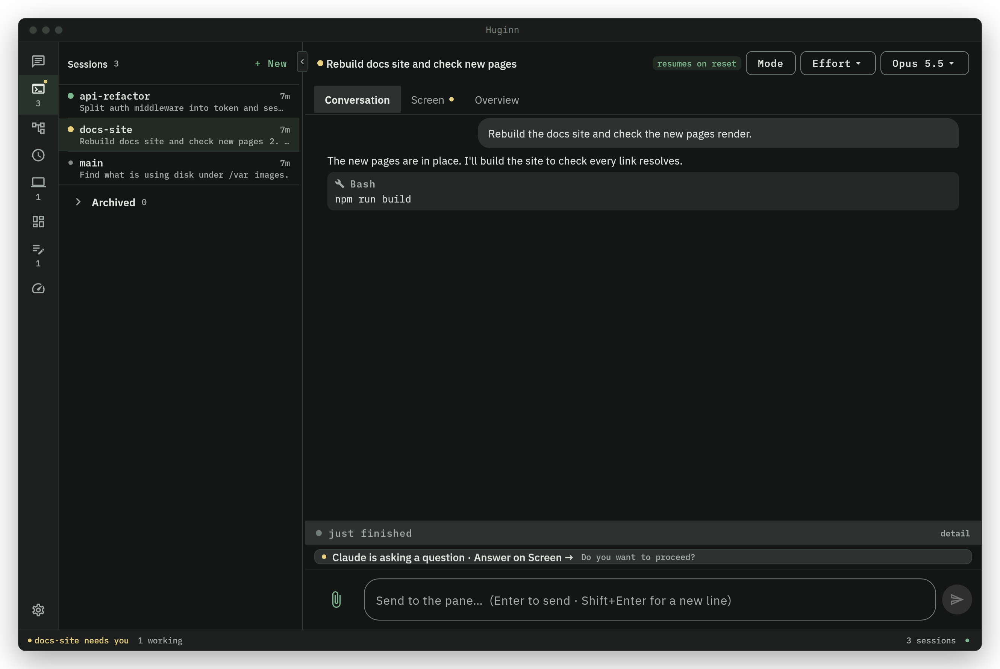
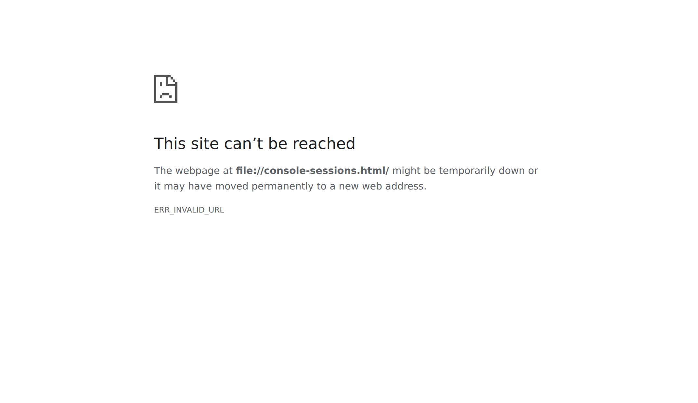

# Sessions

A session is Claude Code running in a tmux session on the server. It keeps running when you close
the laptop, lose Wi-Fi or switch devices, and you can attach to it again from any computer with
the `huginn` command, or watch and answer it from the desktop app and the Android app.

Every session has a name. You can run as many as you like side by side; each one is independent.



## Open a session

```bash
huginn main                 # the session called main, created on first use
huginn api-refactor         # a separate session called api-refactor
huginn attach update        # a session whose name is also a huginn verb
```

| Command | What it does |
|---|---|
| `huginn main` | Attach to the `main` session, creating it if it does not exist. |
| `huginn <name>` | Attach to the session `<name>`, creating it if it does not exist. |
| `huginn attach <name>` | The same, but `<name>` is always read as a session name, never as a verb. Use it for a session called `update`, `list`, `solo`, `console` or any other verb. |
| `huginn` | In a terminal, opens [the console](console.md). Set `HUGINN_CONSOLE=0`, or pipe the command, to attach to `main` instead. |

A new session starts Claude Code for you. When you exit Claude Code, the session stays open with
a login shell in it, where you can run `claude` again or `claude --resume` to pick up an earlier
conversation. Attaching to a session that already exists drops you into it exactly as it is.


Attaching needs SSH access to the server (the `Host huginn` entry the client installer writes).
On a computer set up from the desktop app, run `huginn setup ssh` once first; see
[Install the clients](../install/clients.md).

### Where a new session starts

- A session created from a terminal starts in `$HUGINN_WORKDIR` as the server's SSH login sees
  it, or in the home directory of the SSH user when that is unset or the directory is missing.
- A session created from the desktop app, the Android app or the console starts in the daemon's
  working directory, `HUGINN_APPD_WORKDIR` (default: the daemon user's home); see
  [Server configuration](../reference/server-config.md).

## Session names

Names are lowercase letters, digits, `_` and `-`:

- up to 50 characters;
- must start with a letter, a digit or `_` (not `-`);
- no dots, spaces or `*` (tmux would turn a `.` into `_`, so the session you got would not have
  the name you asked for);
- case-insensitive: `Test` and `test` are the same session.

The same rule applies everywhere: the CLI, the server, the desktop app and the Android app. A name
that breaks it is refused before anything is sent to the server, with the reason.

## List sessions

```bash
huginn list                 # or: huginn ls
```

prints every session on the server with its window count, when it was created, and
`(attached)` when a device is attached to it. `huginn status` adds the server's health: uptime,
Claude Code sign-in, sessions and disk.

Tab completion in bash and PowerShell completes verbs, sub-verbs and the names of live sessions.

The console's sessions screen shows the same list with each session's state and title, and the
last lines of the one that needs you:



## Inside a session

| Key | Action |
|---|---|
| `Alt-d` | Detach: leave the session running and return to your shell (or to the console, if you came from there). `Ctrl-b d` does the same. |
| `Alt-o` | Detach every other device attached to this session, so this one gets the full screen. |
| `Ctrl-b [` | Scroll mode: `PageUp`, `PageDown` and the arrow keys move through the scrollback (50,000 lines); `q` leaves it. |
| `Ctrl-b c` | A new window inside the session. `Ctrl-b n` and `Ctrl-b p` move between windows; `Ctrl-b ,` renames one. |
| `Ctrl-b w` | Pick a window or another session from a list. |

The status bar at the bottom shows the session name and the three keys you need most.

Mouse scrolling is off by default. To turn it on, uncomment `set -g mouse on` in `~/.tmux.conf` of
the server's session user (selecting text with the mouse then needs `Shift`). Running the server
installer again replaces that file and keeps your previous copy beside it: as
`~/.tmux.conf.pre-huginn` the first time, then as `~/.tmux.conf.pre-huginn.1`, `.2` and so on. No
earlier copy is overwritten.

On Termux, `Ctrl-b d` takes three taps. This adds a one-tap `DTACH` key to Termux's extra-keys row
(it backs up your current `~/.termux/termux.properties` first):

```bash
curl -fsSL https://raw.githubusercontent.com/silencelen/huginn/main/client/termux-detach-button.sh | bash
```

## Several devices on one session

When two devices attach the same session, both show it live: what you type on one appears on the
other. tmux sizes the session to the **smallest** attached screen, so both see all of it. On a
large monitor that can mean a small window with empty space around it.

To give one device the full screen:

- `huginn solo` (or `huginn solo <name>`) attaches and detaches every other device in the same
  step;
- `Alt-o` does the same when you are already attached.

The other devices are only detached; the session keeps running, and they can attach again at any
time. Sessions with different names are never mirrored, so use separate names for separate work.

## Staying connected

The session runs on the server, so a dropped link only ends the SSH connection on your side. The
work carries on, and the client reconnects you:

- Any SSH exit other than a clean detach counts as a dropped link. Keepalives make a connection
  that died during sleep fail within about 45 seconds instead of hanging.
- It retries after 2 seconds, doubling the wait up to 15 seconds, with a little random jitter so
  several tabs do not all reconnect at the same instant.
- When it reconnects, it mirrors if another device is still attached, and otherwise takes the
  session full screen (which also clears the stale connection the dropped link left behind).
- It does not recreate a session that was ended from another device while you were away; it says
  the session no longer exists.
- If the connection fails three times in a row within 5 seconds each, the problem is on the server
  side, not the network. The client stops and leaves the server's error on screen.

Press `Ctrl-C` during the wait to stop reconnecting. Set `HUGINN_NO_RECONNECT=1` to turn the
behaviour off.

Restarting or updating the daemon (`huginn-appd`) does not touch running sessions: tmux runs as its
own service on the server. After the server itself reboots, the daemon recreates the sessions that
were running and resumes each conversation with `claude --resume`. A project's sessions come back
with their project name and instructions, as they were first started.

## Terminal tab titles

While you are attached, the terminal tab is named after the session, and the title it had before
is put back when you detach. (bash asks the terminal to save and restore its own title, which
xterm, Windows Terminal, iTerm2, GNOME Terminal and other VTE terminals, kitty, alacritty and foot
support; a terminal without that keeps the session name. PowerShell saves and restores the window
title itself.)

While Claude Code runs, a state mark leads the title:

| Mark | 7-bit | State |
|---|---|---|
| `●` | `*` | working |
| `▲` | `!` | needs you: a question or a permission prompt is waiting for an answer |
| `○` | `o` | waiting: the turn is finished and Claude Code is ready for your next prompt |

The marks come from Claude Code hooks that the server installer sets up for the session user;
the 7-bit marks are used when the server's locale is not UTF-8. Set `HUGINN_NO_TITLE=1` to leave
your tab titles alone. If a tab does not rename, check that your terminal allows applications to
set the title and that the tab title is not pinned.

## Rename a session

```bash
huginn rename main payments          # or: huginn mv main payments
```

A common use is to give `main` a real name once the work has one, which frees `main` for the next
thing.

## End a session

There are three ways to end a session, from gentlest to hardest.

### Soft end: `huginn end`

```bash
huginn end payments
```

Types a wrap-up message into the session ("Finish outstanding items, commit your work, and prepare
to end the session.") so Claude Code can finish and commit. With auto-end on, which is the
default, the session then ends by itself once Claude Code settles.

- If a question is waiting in the session, `huginn end` refuses: answer it first.
- If the session's message box holds text nobody has sent, the wrap-up message waits until the box
  is empty, so it is never sent along with that text. If the box is still not empty after 10
  minutes, nothing is sent, the session is not ended, and the session's send status says why.
- If Claude Code asks a question while it wraps up, auto-end is cancelled and the session stays
  open for you.
- If Claude Code exits before it settles, or the session is ended another way, auto-end stands
  down. A new session you start under the same name is never ended by it.
- `--force` sends the message even when the server has no record of Claude Code running in the
  session (for example a session that is at its shell prompt).

`huginn end` needs the daemon: there is no fallback. The wrap-up message and auto-end are server
settings (`HUGINN_APPD_SOFT_END_PHRASE`, `HUGINN_APPD_SOFT_END_AUTO`); see
[Server configuration](../reference/server-config.md).

### Archive: `huginn archive`

```bash
huginn archive payments              # wrap up, then archive
huginn archive payments --now        # archive without the wrap-up
huginn archive                       # what has been archived
huginn revive payments               # bring it back (by name or archive id)
```

Archiving ends a session for good but keeps the way back: its title, its working directory, the
last thing said, a copy of the transcript, and the exact `claude --resume` command. Like
`huginn end`, it sends the wrap-up message first and refuses while a question is waiting.

`huginn revive` recreates the session in its directory and resumes the conversation, restoring the
transcript from the archive if Claude Code has since removed its own copy. If nothing resumable is
left, you get a fresh Claude Code in the right directory, and the command says so. Attach with
`huginn <name>` afterwards. A conversation you bring back yourself, with its resume command or
Claude Code's `/resume`, is listed as a session again and its archive entry shows where it runs.

### Hard end: `huginn kill`

```bash
huginn kill payments
```

Stops the session now, with no wrap-up. Unsaved work in it is lost. The daemon also clears what it
knew about the session, so a killed session is not brought back after a server reboot. If the
daemon cannot be reached at all, the client ends the tmux session directly.

## See also

- [The console](console.md): the same session actions from a full-screen menu.
- [The apps](apps.md): watch and answer sessions from the desktop app and the Android app.
- [CLI reference](../reference/cli.md) and [Environment variables](../reference/environment.md).
